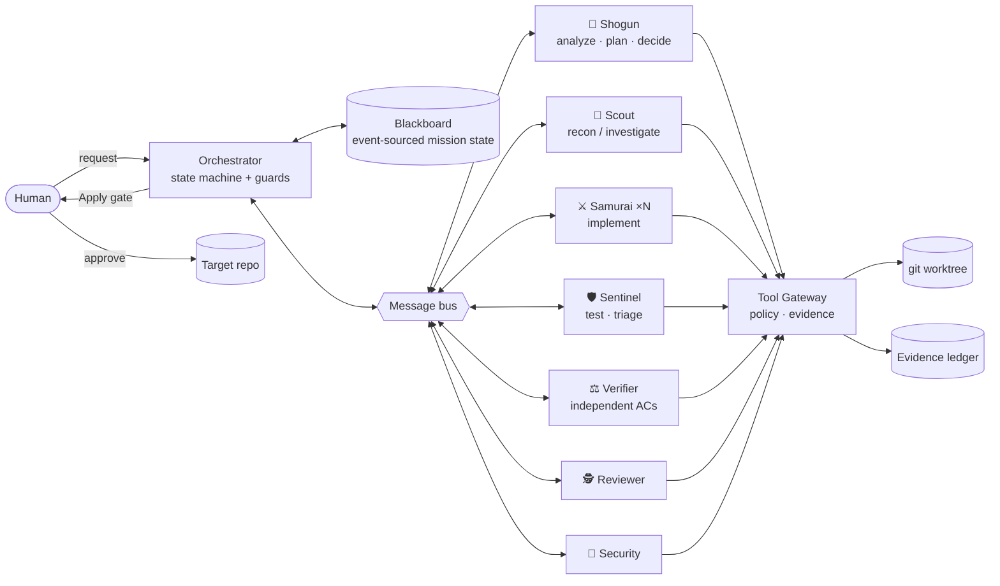

# 404Found — DevPilot 🏯

> **Plan like a Shogun. Build like a Samurai. Test like a Sentinel. Adapt until the mission is complete.**

DevPilot is a multi-agent AI engineering system that turns a natural-language request into a **working, tested, independently verified, and reviewed** change to an existing small repository. It applies the change only after a human approves it, and it never claims success without execution evidence.

> **Status:** design complete, implementation in progress. See [`docs/09-IMPLEMENTATION-PLAN.md`](docs/09-IMPLEMENTATION-PLAN.md). The setup and CLI sections below describe the target interface.

---

## Why it's different

| | Typical "agent pipeline" | DevPilot |
|---|---|---|
| Control flow | Fixed chain of personas | Event-driven state machine; the next step depends on evidence (bounded action set + code guards) |
| "Done" means | The LLM says so | Rule engine: a test or probe passed **on the final code** **and** the independent Verifier gave PASS |
| Verification | Same context that wrote the code | Verifier with **information hiding** that writes its own probe tests |
| Failure handling | Retry until budget | Failure fingerprints: a repeated error forces a strategy change, and a third repeat escalates to a human |
| Safety | Prompt says "be careful" | Tool Gateway: path jail, default-deny command allowlist, no shell, scrubbed env, git-worktree isolation |

---

## Architecture



### Agent responsibilities

| Agent | Responsibility | Can edit code? | Output |
|---|---|---|---|
| 🏯 **Shogun** | Requirement analysis → objectives and acceptance criteria. Plans and replans the task DAG. Makes the decision at every failure or finding, citing evidence. | No | `MissionSpec`, `Plan vN`, `Decision` |
| 🔭 **Scout** | Codebase recon (layout, test command, conventions, risks). Also re-invoked as an investigator. | No | `RepoBrief`, `InvestigationReport` |
| ⚔️ **Samurai** | Implements one task in the worktree, following the repo's style. Spawned dynamically, with parallel instances when tasks touch disjoint files. | **Yes** (worktree only) | `ChangeReport` |
| 🛡️ **Sentinel** | Runs the baseline and the full test suite, classifies regressions, triages failures, and routes its findings to the responsible task. | No | `TestReport` + triage |
| ⚖️ **Verifier** | Checks each acceptance criterion independently and writes probe tests outside the repo. Never sees the developer's reasoning. | Probes only | `VerifierVerdict` |
| 🕵️ **Reviewer** | Reviews correctness, consistency, test quality, scope and regressions. | No | `ReviewReport` |
| 🥷 **Security Inspector** | Secret scan, SAST (bandit or fallback rules) and an LLM injection review. Separates issues the change introduced from pre-existing ones. | No | `SecurityReport` |

Full contracts: [`docs/03-AGENTS.md`](docs/03-AGENTS.md).

### Communication, orchestration, and shared state
- **Blackboard (shared mission state):** an append-only `events.jsonl` projected into a `Mission` object and SQLite. It holds the spec, acceptance criteria, plan history, task status, findings, decisions, open issues and evidence. Each record type has one owner role.
- **Message bus:** typed, addressed messages (`FINDING`, `REQUEST`, `RESPONSE`, `DISPUTE`, `ESCALATION`, …) that cite evidence IDs. Messages to `task:Tn` land in that task's inbox and are injected into the next Samurai briefing. This is how evidence changes the next action.
- **Orchestrator:** a deterministic mission/task state machine. At decision points (test red, verifier reject, review blocker, task blocked, dispute) the Shogun picks one action: `RETRY_SAME_AGENT`, `INVESTIGATE`, `REASSIGN`, `REPLAN`, `ASK_HUMAN`, `STOP_PARTIAL` or `ABORT`. Code **guards** can override that choice (budgets, repeated fingerprints).
- Details: [`docs/04-ORCHESTRATION-AND-STATE.md`](docs/04-ORCHESTRATION-AND-STATE.md).

---

## Setup

**Prerequisites:** Python ≥ 3.11, Git ≥ 2.30, an Anthropic API key. Optional: `ripgrep`, `bandit`, `semgrep` (fallbacks exist for all three).

```bash
git clone <this repo> && cd 404Found
python -m venv .venv && source .venv/bin/activate        # Windows: .venv\Scripts\activate
pip install -e ".[dev]"
cp devpilot.example.toml devpilot.toml
export ANTHROPIC_API_KEY=sk-ant-...                       # Windows PowerShell: $env:ANTHROPIC_API_KEY="..."
```

### Usage

```bash
devpilot run --repo fixtures/fx2_bug_pagination "Users report the last page of results is missing items."
devpilot run --repo ./myrepo "..." --replay demo/fx2.cassette.jsonl   # replay LLM, execute tools for real
devpilot run --repo ./myrepo "..." --mode single                      # single-agent baseline
devpilot approve <mission_id> | devpilot reject <mission_id> --reason "..."
devpilot resume <mission_id>
devpilot report <mission_id> --html
devpilot eval --fixtures fixtures/ --modes multi,single --runs 3
```

### Configuration (`devpilot.toml`)

```toml
[models]
shogun   = "claude-opus-5-5"
verifier = "claude-opus-5-5"
scout    = "claude-sonnet-5-5"
samurai  = "claude-sonnet-5-5"
sentinel = "claude-sonnet-5-5"
reviewer = "claude-sonnet-5-5"
security = "claude-sonnet-5-5"
helper   = "claude-haiku-5-5"

[budgets]
max_attempts_per_task = 3
max_fix_cycles        = 6
max_replans           = 2
max_agent_steps       = 25
max_tokens_mission    = 600000
max_wall_clock_s      = 1200
tool_timeout_s        = 120
llm_concurrency       = 3
max_parallel_samurai  = 3

[gates]
plan  = false          # optional plan approval
apply = true           # ALWAYS true; cannot be disabled

[chaos]                # evaluation only
disable_tools = []     # e.g. ["search.rg", "scan.bandit"]
```
Command and file policy: `config/policy.toml` (see [`docs/05-TOOLS-AND-SANDBOX.md`](docs/05-TOOLS-AND-SANDBOX.md)).

---

## Available tools and execution boundaries

| Tool | What it does | Who may use it |
|---|---|---|
| `fs.list`, `fs.read` | Browse and read workspace files (secret files are redacted) | all |
| `search.code` | Regex search (ripgrep, with a pure-Python fallback) | all |
| `fs.edit`, `fs.write` | Exact-string edit and new-file creation inside the worktree | Samurai |
| `fs.write_probe` | Write probe tests into `runs/<id>/probes/` | Verifier |
| `test.run` | Run the project's tests with structured JUnit results | Scout, Samurai, Sentinel, Verifier |
| `shell.run` | Allowlisted commands only (pytest, ruff, mypy, bandit, npm test, read-only git) | Scout, Samurai, Sentinel, Verifier, Security |
| `git.status/diff/log` | Inspect changes | all |
| `scan.secrets`, `scan.static` | Secret regex and entropy scan; bandit, semgrep, or built-in AST rules | Reviewer, Security |
| `memory.recall` | Cross-mission memory of conventions and lessons | Shogun, Scout, Samurai, Reviewer |
| `board.read`, `msg.send` | Read shared state and message other agents | all (Verifier gets a filtered view) |
| `human.ask` | Ask the human a question | Shogun |

**Boundaries (enforced in code, not prompts):**
- All paths resolve inside `runs/<id>/workspace`. Symlinks and `..` are resolved before checking, and `.git/`, `.env*` and key files are never writable.
- Commands are executed as argv with `shell=False`, a timeout and a scrubbed env (no API keys). Unmatched commands are **denied by default**. `rm`, `git push/reset/clean/commit`, `curl/wget`, `sudo` and shells are always denied. `pip/npm install` requires human approval.
- Edits that change or delete existing test assertions are denied unless the plan allows them.
- Tools that fail 3× in a row trip a circuit breaker, and agents are told to use the fallback.

---

## Human approval mechanism
- **Apply gate (mandatory):** the target repository changes only after the human reviews the diff, the AC status, the test evidence and the review/security results, then approves. The approved branch is applied with `git merge --ff-only`, and DevPilot refuses to apply if the target has uncommitted changes.
- **Clarification gate:** triggered when the request is ambiguous. The Shogun offers 2–4 concrete options.
- **Escalation gate:** triggered by repeated failures, unresolved disputes or environmental errors. The human can give guidance, accept partial results or abort.
- **Command approval:** required for package installs.
- Optional **plan approval** gate.

## Transparency
- A live terminal dashboard shows the plan board, agent activity, every tool call with its rationale, and test status.
- `runs/<id>/events.jsonl` contains every decision, message, tool call and test run.
- `REPORT.md` and `report.html` have separate sections for **Verified**, **Failed / Unverified** and **Model claims (not verified)**, along with feedback loops, plan history and budget usage.

---

## Security assumptions and known limitations
- The target repo's own tests run on the host. **A malicious repository can execute code.** Use DevPilot on code you trust, or with the Docker sandbox (stretch goal).
- Subprocess network access is not blocked at the OS level. The mitigation is that no agent has a network tool and fetch commands are denied.
- Secret redaction is pattern-based and can miss unusual formats.
- Language support is Python/pytest first-class and Node `npm test` basic. It targets small repositories (no embedding index).
- Output depends on the LLM. Replay mode makes demos reproducible, but live runs vary. All reported results come from real test runs, and eval numbers are generated, never hand-written.
- The security inspection is basic. It does not replace a professional audit.

## Evaluation
Five fixture repos cover feature work, bug investigation, test-driven recovery, security review and unexpected conditions (ambiguity, tool outage, repeated failure). Each one is graded by **hidden tests** that agents cannot see, and compared against a single-agent baseline. See [`docs/08-EVALUATION-SCENARIOS.md`](docs/08-EVALUATION-SCENARIOS.md) and `eval/results.md`, which is generated.

## Documentation map

| Doc | Contents |
|---|---|
| [01 Problem Analysis](docs/01-PROBLEM-ANALYSIS.md) | First-principles dissection, requirement traceability matrix, risks |
| [02 Architecture](docs/02-ARCHITECTURE.md) | System diagram, ADRs, sequence diagram, runtime layout |
| [03 Agents](docs/03-AGENTS.md) | Roles, permissions matrix, I/O schemas, prompts, agent loop |
| [04 Orchestration & State](docs/04-ORCHESTRATION-AND-STATE.md) | State machines, blackboard schema, bus, guards, disputes, memory |
| [05 Tools & Sandbox](docs/05-TOOLS-AND-SANDBOX.md) | Tool catalogue, policy, worktree lifecycle, circuit breakers |
| [06 Testing & Verification](docs/06-TESTING-AND-VERIFICATION.md) | Baseline, repair loop, Verifier, completion rules, report format |
| [07 Review, Security, Human Gate](docs/07-REVIEW-SECURITY-HUMAN-GATE.md) | Review severities, scanners, gates, threat model |
| [08 Evaluation](docs/08-EVALUATION-SCENARIOS.md) | Fixtures, metrics, baseline, eval harness |
| [09 Implementation Plan](docs/09-IMPLEMENTATION-PLAN.md) | Repo layout, team split, phased checklists, cut list |
| [10 Demo Script](docs/10-DEMO-SCRIPT.md) | 3-minute demo and reference run log |
| [11 Advanced Engine](docs/11-ADVANCED-ENGINE.md) | **Cognitive modes, model tiers, repo intelligence, spec-first testing, tournaments, scientific debugging, advanced verification** (supersedes older docs where they conflict) |
| [12 Mission Control UI](docs/12-MISSION-CONTROL-UI.md) | Web UI, REST/WebSocket API, design system |
| [13 Build Orchestration](docs/13-BUILD-ORCHESTRATION.md) | Work packets (Claude core / Gemini UI & infra), handoff loop, progress tracker |
