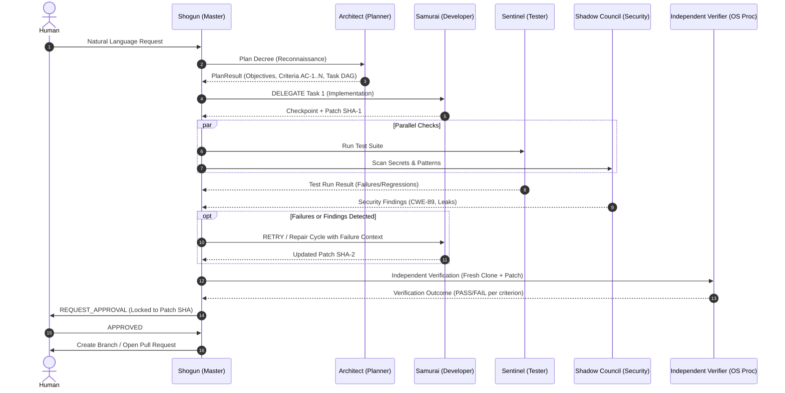

# DevPilot: The Mystic Mikado's Autonomous AI Engineering Guild

> **PECathon 2026 — Problem Statement PS-001**  
> *"Plan like a Shogun. Build like a Samurai. Test like a Sentinel. Review like the Shadow Council. Adapt until the mission is complete."*

---

DevPilot is an autonomous multi-agent engineering guild that turns natural-language software decrees into tested, security-reviewed, and **independently verified** changes against real codebases. 

Unlike naive sequential prompt chains or single-agent loops where models grade their own homework, DevPilot orchestrates specialized agents with strict separation of duties, cryptographic patch verification, deterministic security scanners, and an unbypassable human approval gate.

```
       ┌─────────────────────────────────────────────────────────────┐
       │                Shogun (Master Orchestrator)                 │
       │    LangGraph Hub · Deterministic Policy · Bounded Autonomy  │
       └──────┬───────────────────────┬───────────────────────┬──────┘
              │                       │                       │
     1. Recon │              2. Work  │              3. Parallel
       & Plan │                Orders │                 Verification
              ▼                       ▼                       ▼
      ┌──────────────┐        ┌──────────────┐        ┌──────────────┐
      │  Architect   │        │   Samurai    │   ┌───►│   Sentinel   │
      │  (Planner)   │        │ (Developer)  │   │    │   (Tester)   │
      └──────────────┘        └──────┬───────┘   │    └──────────────┘
                                     │           │    ┌──────────────┐
                         Git Patches │           └───►│Shadow Council│
                                     ▼                │  (Security)  │
                              ┌──────────────┐        └──────────────┘
                              │   Isolated   │                ▲
                              │  Workspace   │                │
                              └──────┬───────┘        4. Critique
                                     │                & Feedback Loop
                                     ▼                        │
                         ┌───────────────────────┐            │
                         │  Independent Verifier │◄───────────┘
                         │ (Separate OS Process) │
                         └───────────┬───────────┘
                                     │ Verified Evidence
                                     ▼
                         ┌───────────────────────┐
                         │  Human Approval Gate  │
                         │ (Bound to Patch SHA)  │
                         └───────────────────────┘
```

---

## Table of Contents
1. [Guild Architecture & Agent Responsibilities](#guild-architecture--agent-responsibilities)
2. [Shared State & Inter-Agent Communication](#shared-state--inter-agent-communication)
3. [The Living Campaign: Adaptive Feedback Loops](#the-living-campaign-adaptive-feedback-loops)
4. [Tooling & Execution Boundaries](#tooling--execution-boundaries)
5. [The Independent Verifier & Approval Gate](#the-independent-verifier--approval-gate)
6. [Supported Evaluation Scenarios (SC-1 to SC-8)](#supported-evaluation-scenarios-sc-1-to-sc-8)
7. [Quickstart & Setup](#quickstart--setup)
8. [Configuration (.env)](#configuration-env)
9. [Verification & Test Suite](#verification--test-suite)
10. [Known Limitations & Security Assumptions](#known-limitations--security-assumptions)

---

## Guild Architecture & Agent Responsibilities

DevPilot organizes agents into a **Hub-and-Spoke LangGraph state machine**. Workers never invoke other workers directly; all evidence flows through the central Master orchestrator.

| Agent | Guild Role | Type | Primary Responsibilities & Permitted Tools |
|---|---|---|---|
| **Shogun** | Master Orchestrator | Policy + Guarded LLM | Evaluates state transitions, schedules tasks, enforces iteration/token/time budgets, detects loops, initiates repair cycles, and gates approvals. |
| **Architect** | Planner & Scout | LLM Tool Loop | Performs read-only codebase reconnaissance (`fs.list`, `fs.read`, `fs.search`), detects conventions and test suites, decomposes missions into task DAGs, and specifies machine-checkable acceptance criteria. **Cannot write files.** |
| **Samurai** | Developer | LLM Tool Loop | Executes implementations in the workspace using file tools (`fs.read`, `fs.edit`, `fs.create`), runs localized self-checks, consumes critiques, and creates git checkpoints. |
| **Sentinel** | Tester | Deterministic + Runner | Executes real test suites (`pytest`, `unittest`, `npm test`), parses test output and stack traces, detects regressions against baseline, and classifies failures. |
| **Shadow Council** | Security & Review | Deterministic Scanners | Scans diffs for exposed secrets (entropy + regex), unsafe patterns (CWE-89 SQLi, CWE-78 command injection, CWE-502 unsafe deserialization), and test-tampering attempts. Emits structured critiques. |
| **Independent Verifier** | Judge & Gatekeeper | Isolated OS Subprocess | Runs in a fresh clone of the base commit + patch only, with zero agent context and zero database access. Evaluates acceptance criteria against ground truth. |

---

## Shared State & Inter-Agent Communication

DevPilot rejects naive prompt concatenation. All communication is structured and persisted:

1. **Typed Message Bus**: Agents exchange typed messages (`TASK_ASSIGN`, `TASK_ACK`, `TASK_RESULT`, `CRITIQUE`, `CRITIQUE_RESPONSE`, `STATUS`, `ESCALATION`). Every message requires an `idempotency_key` and explicitly references evidence IDs.
2. **Immutable Patch State (`patch_sha256`)**: Every code modification updates git and generates an immutable cryptographic SHA-256 hash of the git diff. All test runs, security findings, and approvals are bound to this exact SHA.
3. **Single Source of Truth Database**: SQLite aggregates (`missions`, `tasks`, `decisions`, `tool_calls`, `test_runs`, `findings`, `verifications`, `human_requests`, `repositories`, `audit_events`).
4. **Real-Time SSE Stream**: Live Server-Sent Events (`/api/v1/missions/{id}/events`) stream all agent reasoning, tool invocations, and test outputs to the UI with `Last-Event-ID` reconnection support.



---

## The Living Campaign: Adaptive Feedback Loops

DevPilot's defining differentiator is its ability to **adapt when evidence contradicts initial assumptions**.

### The Canonical Feedback Loop (Demonstrated in SC-3)
1. **Initial Execution**: The Samurai developer inspects a broken pricing module (`calc.py`) and fixes `add()` (`a - b` → `a + b`).
2. **Failure Investigation**: The Sentinel test runner executes the test suite. `test_add` now passes, but a secondary, hidden defect is revealed in `total()` (rounding error).
3. **Fingerprint Tracking & Watchdog**: The Master agent's loop watchdog calculates a failure fingerprint from the traceback. It notes that the failure signature changed (`fingerprint_A` → `fingerprint_B`).
4. **Adaptive Strategy**: Rather than repeating the first edit, Master dispatches a `RETRY` repair cycle containing the new failure context.
5. **Successful Convergence**: Developer updates `round(s, 1)` to `round(s, 2)`. Tests rerun green on a fresh patch hash, verifier passes, and human approval is requested.

```
[test.failed] ──► [repair.initiated] ──► [fs.edit: fix add()] ──► [test.failed (new signature)] ──► [repair.initiated] ──► [fs.edit: fix total()] ──► [test.passed]
```

---

## Tooling & Execution Boundaries

Agents interact with the repository strictly through structured tools. No agent has raw terminal access or unconstrained shell execution.

### Tool Registry
- **File System (`fs.*`)**: `fs.read`, `fs.list`, `fs.search`, `fs.edit`, `fs.create`, `fs.delete`.
- **Git (`git.*`)**: `git.status`, `git.diff`, `git.checkpoint`, `git.rollback`.
- **Testing & Verification (`check.*`)**: `check.test` (auto-detects `pytest`, `unittest`, `npm test`), `check.lint`, `check.build`.
- **Security Scanners (`sec.*`)**: `sec.scan_secrets`, `sec.scan_patterns`, `sec.audit_deps`, `sec.review_quality`.
- **Mission Handoffs**: `submit_plan`, `submit_result`, `mission.record_finding`, `mission.report_blocker`.

### Multi-Layer Security Boundaries
1. **Path Jail**: Every file tool resolves symlinks and canonical realpaths. Access outside the active workspace directory raises immediate traversal errors (`PATH_JAIL_VIOLATION`).
2. **Command Policy Allowlist**: Arbitrary shell commands are blocked. Shell metacharacters (`|`, `&`, `;`, `$`, `` ` ``, `>`, `<`) are rejected at the parser level. Only registered binaries from safe profiles (`python`, `pytest`, `npm`, `git`) are permitted.
3. **Dual-Layer Sandbox**: 
   - **Container Layer**: The backend runs as non-root (`uid 10001`) inside Docker with CPU/memory quotas and isolated volume mounts.
   - **Process Layer**: Subprocesses run with strict OS limits (`RLIMIT_CPU`, `RLIMIT_FSIZE` capped at 100MB, `RLIMIT_NOFILE` capped at 512, scrubbed environment variables).
4. **Test-Tamper Detection**: DevPilot computes a diff of test directories before and after runs. If a developer agent deletes, comments out, weakens assertions, or adds `@pytest.mark.skip` to cheat the tests, the tamper detector flags the attempt and blocks completion.
5. **Secret Redaction**: Logs, tool calls, and API responses scrub high-entropy tokens, passwords, and API keys automatically.

---

## The Independent Verifier & Approval Gate

### 1. The Independent Verifier Subprocess
To satisfy PS-001's strict rule that *"the system must not claim success without evidence"*, DevPilot isolates verification from the agent graph:
- A separate Python process (`app/verifier/process.py`) is spawned in a separate sandbox.
- It clones the repository clean from `base_commit`, applies the final patch file, and evaluates every acceptance criterion independently.
- It shares **no memory, no database connection, and no agent state**.

### 2. The Human Approval Gate
Consequential actions (applying changes to source repos, pushing git branches, opening GitHub Pull Requests) are impossible without human sign-off:
- The approval request displays a syntax-highlighted side-by-side diff.
- Human approval is **cryptographically locked** to `patch_sha256`. If any agent modifies a file after approval is requested, the token is invalidated and the gate locks.
- Users can inspect security findings, test evidence logs, and audit trails before approving.

---

## Supported Evaluation Scenarios (SC-1 to SC-8)

DevPilot includes a complete test harness in `eval/scenarios/` covering every PS-001 evaluation category:

| ID | Category | Scenario Name | Description |
|---|---|---|---|
| **SC-1** | Feature Implementation | `Add note search functionality` | Implements case-insensitive search across notes; adds new test cases while preserving baseline behavior. |
| **SC-2** | Bug Investigation | `Fix duplicated item on page 2` | Diagnoses off-by-one pagination defect; reproduces with a failing test before applying a minimal fix. |
| **SC-3** | Test-Driven Recovery | `Make the failing tests pass` | Two stacked bugs; fixing `add()` exposes a second failure in `total()`. Demonstrates multi-round feedback loop. |
| **SC-4** | Security & Code Review | `Fix SQL injection and review security` | Catches planted SQL f-string (CWE-89); gate blocks approval; developer repairs with parameterized query; re-scan passes. |
| **SC-5** | Unexpected Conditions | `Add age validation (Missing Tool)` | `pytest` is unavailable in sandbox. Sentinel falls back to `unittest`, marks evidence degraded, and avoids hallucinating pass. |
| **SC-6** | Unexpected Conditions | `Make checkout faster (Ambiguity)` | Intentionally vague request. Architect halts execution and asks human clarification before touching any code. |
| **SC-7** | Unexpected Conditions | `Contradictory tests (Repeated Failures)` | Contradictory test specifications. Detects repeated failure loop, alters strategy once, and cleanly escalates to human without looping. |
| **SC-8** | Adaptive Planning | `Adaptive Re-planning` | Initial plan targets a non-existent file. Architect detects reconnaissance mismatch, supersedes tasks, and revises DAG. |

---

## Quickstart & Setup

### Prerequisites
- Docker & Docker Compose (Recommended) **OR**
- Python >= 3.11 & Node.js >= 20 (Local execution)

### Method 1: Docker (Fastest, Full Isolation)

```bash
# 1. Clone repository
git clone https://github.com/PECathon-2026/404Found.git
cd 404Found

# 2. Configure environment (optional: add model keys or GitHub token)
cp backend/.env.example backend/.env

# 3. Start the backend container
docker compose up -d

# 4. Start frontend dashboard
cd frontend
npm install
npm run dev -- -p 3001
```
Open **`http://localhost:3001`** in your browser.

---

### Method 2: Local Development (Without Docker)

```bash
# Backend setup
cd backend
python3 -m venv .venv
source .venv/bin/activate
pip install -e . pytest pytest-asyncio ruff asgi-lifespan python-multipart
cp .env.example .env
python -m uvicorn app.main:app --port 8000 --reload

# In another terminal: Frontend setup
cd frontend
npm install
npm run dev -- -p 3001
```

---

## Configuration (.env)

Copy `backend/.env.example` to `backend/.env`:

```env
# Storage directory for workspaces, databases, and logs
DEVPILOT_DATA_DIR=./data

# Model Providers (Choose any or multiple)
# Live models are optional: without keys, all demo scenarios run with deterministic replays
ANTHROPIC_API_KEY=sk-ant-api03-...
ANTHROPIC_MODEL=claude-3-5-sonnet-20241022

OPENAI_API_KEY=sk-proj-...
OPENAI_MODEL=gpt-4o
OPENAI_BASE_URL=https://api.openai.com/v1

# Free Google Gemini support via OpenAI-compatible endpoint:
# OPENAI_API_KEY=AIzaSy...
# OPENAI_BASE_URL=https://generativelanguage.googleapis.com/v1beta/openai/
# OPENAI_MODEL=gemini-2.5-flash

# GitHub Token (Optional: clone private repos, push branches, open PRs)
GITHUB_TOKEN=ghp_...

# CORS Allowed Origins
DEVPILOT_CORS_ORIGINS=http://localhost:3000,http://localhost:3001,http://127.0.0.1:3000,http://127.0.0.1:3001
```

---

## Verification & Test Suite

Run the full verification suite across backend and frontend:

```bash
# Backend unit & integration test suite (115+ tests)
cd backend
./.venv/bin/pytest tests/unit -v
./.venv/bin/pytest tests/integration/test_api.py -v
./.venv/bin/pytest tests/integration/test_e2e_sc3.py -v

# Code quality & type checks
./.venv/bin/ruff check app tests
cd ../frontend && npx tsc --noEmit && npm run build
```

---

## Known Limitations & Security Assumptions

In the spirit of honest engineering and transparent reporting:
1. **Target Language Ecosystems**: Python (`pytest`, `unittest`) and JavaScript/TypeScript (`npm test`) are fully auto-detected. Repositories in compiled languages (Rust, Go) work if the build/test commands are pre-installed in the environment.
2. **Sandbox Network Isolation**: The sandbox blocks outgoing network traffic during agent execution. Packages cannot be installed ad-hoc during a mission; dependencies must exist in the target repo's virtualenv or container.
3. **Model Non-Determinism**: While the LangGraph state machine, policy guards, verifier, and gate transitions are 100% deterministic, LLM natural language interpretations may vary across runs. Scripted scenarios provide fully reproducible reference runs.
4. **Local vs Cloud Memory**: Cross-mission memory stores learnings locally in SQLite per repository; multi-tenant cloud storage is not implemented.

---

## License

Built for **PECathon 2026**. Distributed under the MIT License.
