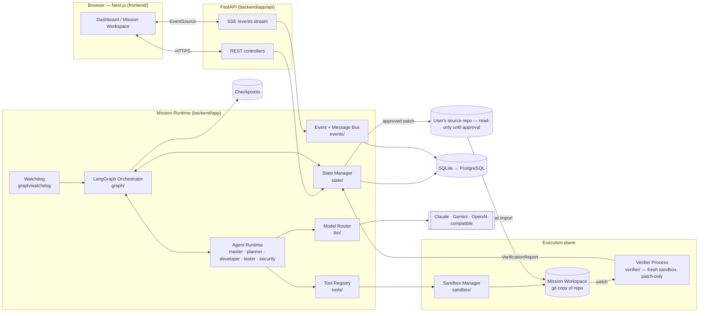
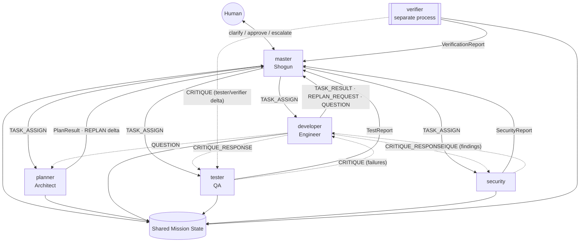
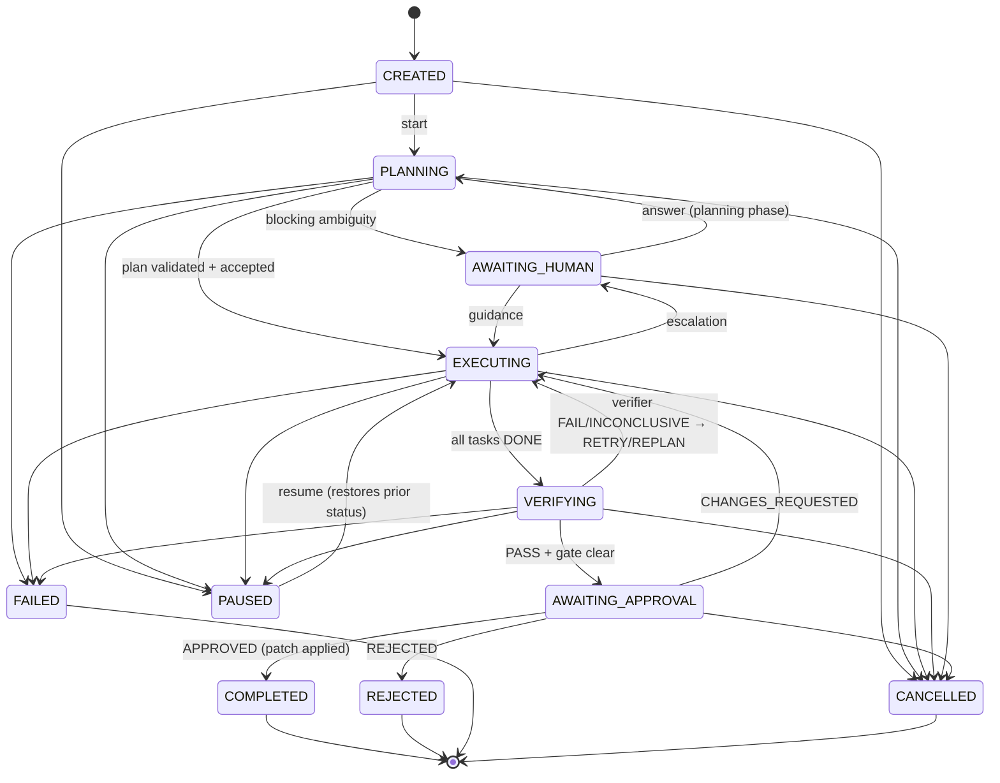
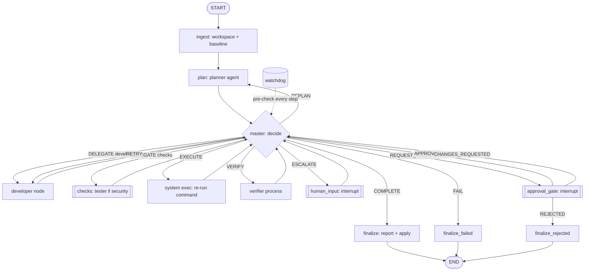
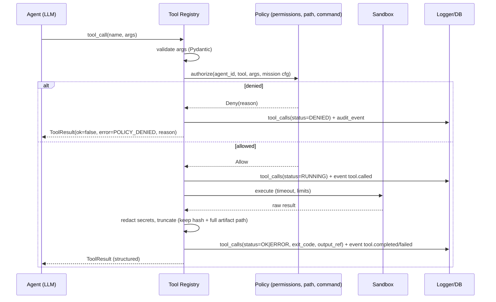
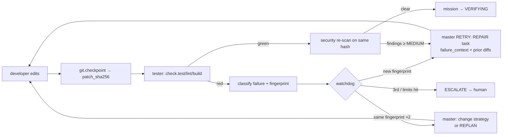
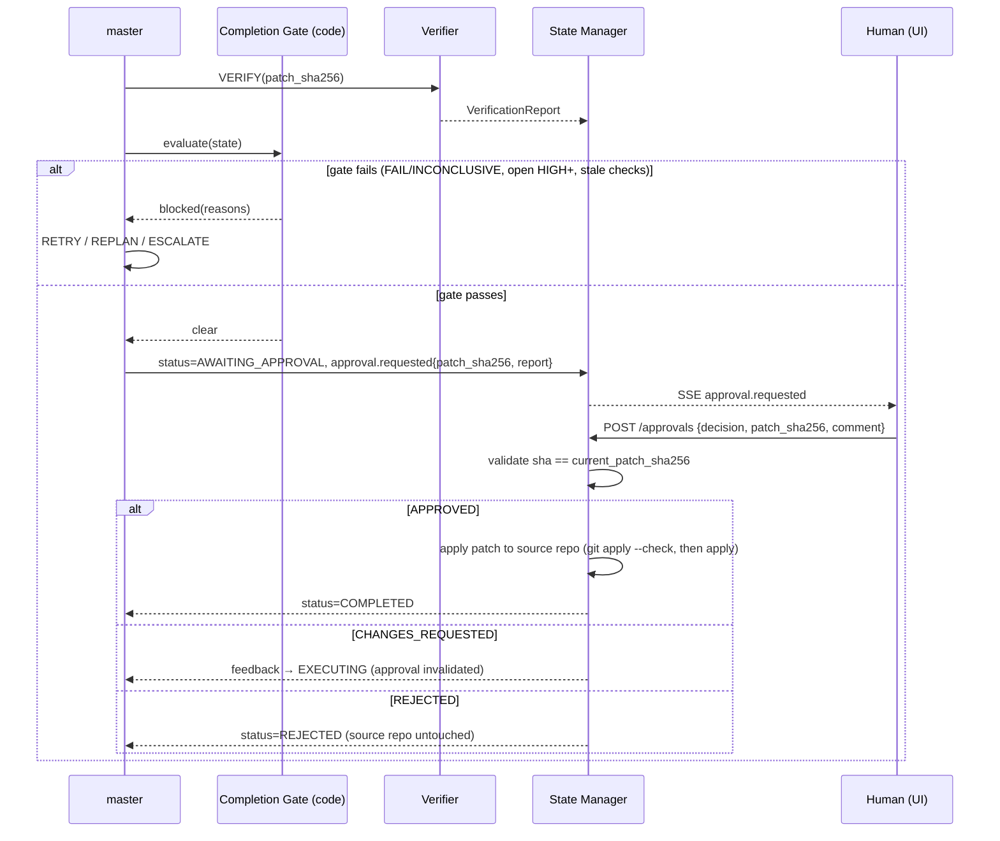

# ARCHITECTURE.md — DevPilot Technical Design

> Canon: [AGENTS.md §0](AGENTS.md#0-canonical-names-the-single-naming-authority) (names, enums, IDs, lifecycle). Plan & tasks: [PLAN.md](PLAN.md), [PROGRESS-TRACKER.md](PROGRESS-TRACKER.md). UI: [UI-REGISTRY.md](UI-REGISTRY.md).
> This document describes the **target design**. Nothing here is implemented until PROGRESS-TRACKER.md says `VERIFIED`.

**MVP vs. production.** Each section marks `[MVP]` or `[PROD]`. MVP = SQLite, in-process event bus, LangGraph `SqliteSaver`, local Docker or local-jail sandbox, single worker process. PROD (X-6) = PostgreSQL, Redis streams, `PostgresSaver`, worker pool, per-mission containers on a remote host. The code is written against interfaces so the swap is configuration, not rewrite.

---

## A. System Architecture

### A.1 Overall system



### A.2 Agent interaction topology


Solid lines: master-mediated control flow. Dotted: direct agent-to-agent critique (still persisted as envelopes and visible to master).

### A.3 Mission lifecycle


(PAUSED returns to whichever status it was paused from; diagram abbreviates.)

### A.4 LangGraph state machine


Hub-and-spoke: every worker node returns to `master`; `master` is the only router. This is the adaptive core: the next node is chosen from current evidence, not a fixed order (R-E3).

### A.5 Tool execution flow



### A.6 Feedback and repair loop



### A.7 Human approval workflow



### A.8 Deployment architecture

```mermaid
flowchart TB
  subgraph Host["Single host — docker compose [MVP]"]
    FE[frontend :3000]
    BE[backend :8000<br/>FastAPI + LangGraph worker]
    DBM[(SQLite volume)]
    subgraph SB["Sandbox network: none"]
      C1[mission container<br/>/workspace · non-root · no network]
      C2[verifier container<br/>fresh from base + patch]
    end
    DS[[docker.sock — via narrow sandbox manager only]]
  end
  FE --> BE
  BE --> DBM
  BE --> DS
  DS --> C1
  DS --> C2
  BE --> EXT[[Model provider APIs (egress allowlist)]]
  subgraph Prod["[PROD] scale-out"]
    LB[Load balancer] --> BE1[API pods]
    BE1 --> PG[(PostgreSQL)]
    BE1 --> RD[(Redis streams)]
    WK[Worker pool] --> RD
    WK --> RS[Remote sandbox hosts / gVisor]
  end
```
Security note: giving the backend docker.sock is equivalent to root on the host; MVP accepts this for a single-user demo and records it as a known limitation. PROD uses a remote sandbox host / rootless Docker / gVisor and never exposes the socket to the API process.

---

## B. LangGraph Orchestration

### B.1 Graph state

```python
# backend/app/graph/state.py
class GraphState(TypedDict):
    mission: MissionState                      # AGENTS.md §D (Pydantic, serialized by checkpointer)
    pending_decision: MasterDecision | None    # last decision awaiting dispatch
    last_result: AgentResult | None            # most recent worker output
    interrupt: HumanRequest | None             # when waiting on a human
    step: int                                  # total graph steps (limit 60)
```
Only `master` and the State Manager mutate `mission` structure; workers return `AgentResult` + patches that the State Manager applies atomically (`state_version` CAS).

### B.2 Nodes

| Node | Kind | Responsibility |
|---|---|---|
| `ingest` | system | Copy repo to workspace, git baseline commit, detect commands, run **baseline test run** (`baseline_run_id`) before any edit. |
| `plan` | agent (`planner`) | Recon + `PlanResult`; also handles replan deltas. |
| `master` | agent (`master`) + guard | Produce `MasterDecision`; guard validates vs. §0.4 transitions and §B.4 preconditions; watchdog pre-check. |
| `dev` | agent (`developer`) | Executes IMPLEMENT/REPAIR task. |
| `checks` | parallel (`tester` ‖ `security`) | Run on the same immutable `patch_sha256`. |
| `exec` | system | Master's `EXECUTE`: re-run a contested/verification command via `shell.run`/`check.*` as `system`. |
| `verify` | system → process | Launch verifier; collect `VerificationReport`. |
| `human_input` | interrupt | Clarification/escalation; resumes with `HumanResponse`. |
| `approval_gate` | interrupt | Waits for `POST /approvals`. |
| `finalize*` | system | Report generation, patch apply (only on APPROVED), cleanup. |

### B.3 Python-oriented pseudocode

```python
# backend/app/graph/build.py
from langgraph.graph import StateGraph, START, END
from langgraph.checkpoint.sqlite.aio import AsyncSqliteSaver
from langgraph.types import interrupt, Command, Send

def build_graph(deps: Deps) -> CompiledGraph:
    g = StateGraph(GraphState)

    g.add_node("ingest", nodes.ingest(deps))
    g.add_node("plan", nodes.plan(deps))
    g.add_node("master", nodes.master(deps))
    g.add_node("dev", nodes.developer(deps))
    g.add_node("checks", nodes.checks(deps))         # fan-out/fan-in inside (see B.7)
    g.add_node("exec", nodes.system_exec(deps))
    g.add_node("verify", nodes.verify(deps))
    g.add_node("human_input", nodes.human_input(deps))
    g.add_node("approval_gate", nodes.approval_gate(deps))
    g.add_node("finalize", nodes.finalize(deps, outcome="COMPLETED"))
    g.add_node("finalize_rejected", nodes.finalize(deps, outcome="REJECTED"))
    g.add_node("finalize_failed", nodes.finalize(deps, outcome="FAILED"))

    g.add_edge(START, "ingest")
    g.add_edge("ingest", "plan")
    g.add_edge("plan", "master")
    for worker in ("dev", "checks", "exec", "verify", "human_input"):
        g.add_edge(worker, "master")

    g.add_conditional_edges("master", route_from_master, {
        "dev": "dev", "checks": "checks", "plan": "plan", "exec": "exec", "verify": "verify",
        "human_input": "human_input", "approval_gate": "approval_gate",
        "finalize": "finalize", "finalize_failed": "finalize_failed",
    })
    g.add_conditional_edges("approval_gate", route_from_approval, {
        "master": "master", "finalize_rejected": "finalize_rejected",
    })
    g.add_edge("finalize", END); g.add_edge("finalize_rejected", END); g.add_edge("finalize_failed", END)

    return g.compile(checkpointer=deps.checkpointer, interrupt_before=[])  # interrupts are in-node

def route_from_master(s: GraphState) -> str:
    d = s["pending_decision"]
    return {
        MasterAction.PLAN: "plan", MasterAction.REPLAN: "plan",
        MasterAction.DELEGATE: "checks" if d.target_agent in ("tester", "security") else "dev",
        MasterAction.RETRY: "dev",                       # RETRY of a checks task routes by target_agent
        MasterAction.EXECUTE: "exec",
        MasterAction.VERIFY: "verify",
        MasterAction.ESCALATE: "human_input",
        MasterAction.REQUEST_APPROVAL: "approval_gate",
        MasterAction.COMPLETE: "finalize",
        MasterAction.FAIL: "finalize_failed",
    }[d.action]
```

```python
# backend/app/graph/nodes/master.py
async def master_node(state: GraphState, deps: Deps) -> dict:
    m = state["mission"]
    # 1. watchdog is deterministic and runs first
    wd = deps.watchdog.check(m, state["step"])          # -> WatchdogVerdict(force_action?, reasons)
    # 2. ask the LLM for a decision (structured output) unless watchdog forces one
    if wd.force_action:
        decision = MasterDecision.forced(wd.force_action, wd.reasons)
    else:
        try:
            decision = await deps.agents.master.decide(digest(m), budget=m.budgets)
        except (ModelError, ValidationError):
            decision = fallback_policy(m)               # AGENTS.md §B.1.1
    # 3. guard: reject illegal action for the current state
    ok, why = guard.validate(m, decision)               # transitions + preconditions (B.4)
    if not ok:
        decision = await deps.agents.master.redecide(digest(m), violation=why) or fallback_policy(m)
        ok, why = guard.validate(m, decision)
        if not ok:
            decision = MasterDecision.forced(MasterAction.ESCALATE, [why])
    # 4. persist decision, apply deterministic state effects, emit events
    await deps.state.record_decision(m.mission_id, decision)       # decisions table + decision.made
    await deps.state.apply_decision_effects(m.mission_id, decision) # task statuses, status transition
    return {"pending_decision": decision, "step": state["step"] + 1}
```

### B.4 Routing logic and preconditions (enforced by `guard.validate`)

| Action | Allowed when | Effect |
|---|---|---|
| `PLAN` | status ∈ {PLANNING}; no plan yet | run planner |
| `DELEGATE` | target task `READY` (deps `DONE`); agent permitted for `TaskKind`; agent not already holding a task (unless parallel mode) | assignment, `task.delegated` |
| `EXECUTE` | contested/verifying command exists; command passes policy | system re-run, evidence appended |
| `RETRY` | task `FAILED`/`IN_REVIEW` with failure; `task.retries < max_retries`; fingerprint not repeated >1 | new attempt with failure context |
| `REPLAN` | `replans < 2`; REPLAN_REQUEST or verifier FAIL on uncovered criterion | planner delta |
| `VERIFY` | all non-superseded IMPLEMENT/WRITE_TESTS/REPAIR tasks `DONE`; latest `check.*` green on current `patch_sha256`; no open finding ≥ HIGH | launch verifier |
| `ESCALATE` | any trigger in AGENTS §B.1.2 | `AWAITING_HUMAN` |
| `REQUEST_APPROVAL` | completion gate clear (B.6) | `AWAITING_APPROVAL` |
| `COMPLETE` | `Approval=APPROVED` for current `patch_sha256` and gate clear | terminal `COMPLETED` |
| `FAIL` | limits exhausted & human did not rescue, or unrecoverable error | terminal `FAILED` |

### B.5 Completion gate (`state/gate.py`, pure function, unit-tested with a truth table)

```python
def completion_gate(m: MissionState) -> GateResult:
    reasons = []
    v = m.verification
    if v is None or v.patch_sha256 != m.current_patch_sha256: reasons.append("no verification for current patch")
    elif v.overall != "PASS":                                  reasons.append(f"verifier overall={v.overall}")
    if any(c.status != "PASS" for c in m.acceptance_criteria): reasons.append("criteria not all PASS")
    if any(f.severity >= HIGH and f.status in {OPEN, DISPUTED} for f in m.findings): reasons.append("open HIGH/CRITICAL finding")
    if not latest_checks_green_for(m, m.current_patch_sha256): reasons.append("checks not green on current patch")
    if v and (v.tamper_check.modified_existing_tests and not human_waived_tamper(m)): reasons.append("existing tests modified without human waiver")
    return GateResult(clear=not reasons, reasons=reasons)
```
`REQUEST_APPROVAL` requires `clear`; `COMPLETE` requires `clear` **and** `APPROVED`.

### B.6 Checkpointing, interrupt/resume

- **Checkpointer:** `AsyncSqliteSaver` [MVP] / `AsyncPostgresSaver` [PROD]; thread id = `mission_id`. Additionally the State Manager writes a row to `checkpoints` (our table) on every status change and every `patch_sha256` change, for UI replay and rollback (`ckp_` ids).
- **Interrupts:** `human_input` and `approval_gate` call `interrupt(payload)`; the graph suspends; mission status is `AWAITING_HUMAN`/`AWAITING_APPROVAL`; the API endpoints (`/respond`, `/approvals`) resume by `graph.ainvoke(Command(resume=response), config={"configurable": {"thread_id": mission_id}})`.
- **Pause:** a pause flag checked by the watchdog between nodes (cooperative); in-flight tool calls finish or are cancelled via sandbox `kill`. Resume continues from last checkpoint.
- **Crash recovery:** on backend start, missions in `PLANNING/EXECUTING/VERIFYING` are re-attached: in-flight `agent_executions` marked `ABORTED`, the node is re-run from the last checkpoint (nodes are idempotent per §H).

### B.7 Parallel execution

- `checks` node: `asyncio.gather(tester.run(...), security.run(...))` over an **immutable** snapshot (`patch_sha256`); both read-only wrt. source (tester may add tests only in a `WRITE_TESTS` task, never in `checks`). Results merged by the State Manager; ordering is irrelevant.
- **Parallel developers [P1, B-1]:** `Send("dev", {task_id: t})` for each READY IMPLEMENT task whose `files_hint` sets are pairwise disjoint; each gets `git worktree add /workspace/.wt/<task_id>`; on completion the State Manager applies patches in dependency order with `git apply --3way`; conflicts create a `REPAIR(merge)` task. Max parallel developers = `config.max_parallel_developers` (default 2).

### B.8 Retry, limits, termination

| Limit | Default | On exceed |
|---|---|---|
| per-task retries | 3 | ESCALATE |
| identical failure fingerprint | 2 consecutive | strategy change; 3rd → ESCALATE |
| mission `repair_cycles` | 8 | ESCALATE |
| `replans` | 2 | ESCALATE |
| graph steps | 60 | FAIL |
| wall-clock | 20 min (config) | pause + ESCALATE, then FAIL after human timeout |
| tokens / cost | 400k / \$2.00 | `budget.warning` at 80 %, ESCALATE at 100 % |
| human wait | 24 h | FAIL (or stay waiting if `config.wait_indefinitely`) |

**Termination conditions:** `COMPLETED` (gate + approval), `REJECTED` (human), `CANCELLED` (human), `FAILED` (limits/unrecoverable). Anything else is non-terminal. **Failure recovery:** node exceptions are caught by the runtime wrapper → `agent_executions.status=ERROR` + `STATUS` message to master; master chooses RETRY/ESCALATE; the wrapper never swallows errors silently.

---

## C. Backend Architecture

### C.1 Folder structure (canonical)

```
backend/
├── pyproject.toml  alembic.ini  Makefile
├── alembic/versions/
└── app/
    ├── main.py                      # FastAPI factory, lifespan, DI wiring
    ├── config.py                    # Settings (pydantic-settings), model/budget/sandbox config
    ├── api/
    │   ├── deps.py  errors.py  schemas/        # request/response Pydantic models
    │   └── routes/{missions,control,tasks,messages,logs,diffs,tests,findings,approvals,repositories,events,metrics,health}.py
    ├── state/
    │   ├── models.py                # MissionState & sub-models (AGENTS.md §D)
    │   ├── enums.py                 # AGENTS.md §0.3 (single source)
    │   ├── manager.py               # StateManager: versioned writes, locks, effects
    │   ├── transitions.py           # lifecycle table + guard
    │   └── gate.py                  # completion gate
    ├── graph/
    │   ├── build.py  state.py  routing.py  watchdog.py  fallback.py
    │   └── nodes/{ingest,plan,master,developer,checks,system_exec,verify,human,approval,finalize}.py
    ├── agents/
    │   ├── runtime.py               # tool loop, structured output, budgets, heartbeat
    │   ├── {master,planner,developer,tester,security}/{agent.py,prompts.py,schemas.py}
    │   └── prompts/                 # shared fragments (untrusted-content rule, evidence rules)
    ├── tools/
    │   ├── base.py  registry.py  permissions.py  results.py  redact.py
    │   ├── fs.py  shell.py  git.py  checks.py  security.py  mission.py
    │   ├── parsers/{pytest.py,unittest.py,jest.py,ruff.py}
    │   └── tamper.py
    ├── sandbox/
    │   ├── manager.py  workspace.py  pathjail.py  policy.py
    │   ├── local_jail.py  docker_runner.py  limits.py
    ├── verifier/
    │   ├── main.py                  # entrypoint: python -m app.verifier --spec spec.json
    │   ├── methods.py  judge.py  report.py
    ├── events/{bus.py,persist.py,sse.py,messages.py}
    ├── db/{models.py,session.py,repositories/*.py}
    ├── llm/{router.py,providers/{anthropic.py,gemini.py,openai_compat.py,fake.py},structured.py,ledger.py,pricing.py}
    ├── services/{missions.py,approvals.py,reports.py,replay.py,repos.py}
    └── observability/{logging.py,trace.py,metrics.py,audit.py}
```

### C.2 Service boundaries (dependency direction: top depends on bottom, never reverse)

```
api ─▶ services ─▶ state ─▶ db
                └▶ graph ─▶ agents ─▶ tools ─▶ sandbox
                         └▶ llm            └▶ db (tool_calls)
verifier ─▶ sandbox, llm, (own spec file)   # no import of agents/, no db message access
events ◀─ everything (publish only)
```
Rules: `tools` never import `agents`; `agents` never import `api`; `verifier` imports nothing from `agents` or `graph` (enforced by an import-linter test); all cross-module calls take interfaces from `*/base.py`/`Protocol` types so tests inject fakes (DI via a `Deps` dataclass built in `main.py`).

### C.3 Component responsibilities

- **API controllers** (`api/routes`): validate, authorize (MVP: single local user), call services, never contain orchestration logic.
- **Agent runtime** (`agents/runtime.py`): standard loop — build messages (system + task + state slice), call model with tool schemas, execute tool calls via registry, append results (delimited as untrusted data), repeat until the model returns the final structured result or limits hit (max tool calls per invocation: 25; max wall-clock per invocation: 5 min; heartbeat every tool call). Records `agent_executions` and `model_calls`.
- **Tool registry** (`tools/registry.py`): name → `Tool` object (schema, handler, permission tags). Per-agent allow-list from `permissions.py`.
- **Repository manager** (`services/repos.py`, `sandbox/workspace.py`): import local path/git URL; copy into `workspaces/<mission_id>/` (excluding `.env*`, `*.pem`, secrets patterns → recorded as `excluded`), `git init` if needed, baseline commit; compute `base_commit`; export patch (`git diff base..HEAD`) and `patch_sha256`.
- **Sandbox manager** (`sandbox/manager.py`): chooses runner (`docker` | `local_jail`), enforces limits, kills on timeout/cancel, returns `ExecResult`.
- **State manager** (`state/manager.py`): single write path to mission state; optimistic concurrency; emits events; owns file locks table for parallel mode.
- **Event streaming** (`events/`): `bus.publish(event)` persists to `audit_events` (stream table) then fans out to subscribers; SSE endpoint reads `Last-Event-ID` and replays from DB, then tails live.
- **DB repositories** (`db/repositories/*`): one per aggregate; SQLAlchemy 2.0 async; no business logic.
- **Observability** (`observability/`): `structlog` JSON logs with `mission_id/task_id/agent_id/correlation_id`; trace spans per agent execution and tool call (stored in DB; OpenTelemetry export [PROD]); metrics computed per AGENTS §G.

---

## D. Database Design

SQLAlchemy 2.0 + Alembic. SQLite [MVP] / PostgreSQL [PROD]; use portable types (`JSON` → `JSONB` on PG). All ids are ULID strings with prefixes (AGENTS §0.7). All tables have `created_at`; mutable ones have `updated_at`. All FKs `ON DELETE CASCADE` from `missions` (retention purge is one delete).

```
users(id PK, email UNIQUE, display_name, role, created_at)          -- [MVP] single seeded local user; kept for approvals/audit authorship
repositories(id PK 'rep_', name, source_type {LOCAL_PATH or GIT_URL}, source_ref, default_branch, language_hints JSON,
             head_commit, created_by→users, created_at)
missions(id PK 'mis_', repository_id→repositories, title, request TEXT, status, status_reason, config JSON,
         criteria_version INT, current_patch_sha256, state_version INT, repair_cycles INT, replans INT, steps INT,
         budget_tokens_limit, budget_tokens_used, budget_cost_limit_usd, budget_cost_used_usd,
         workspace_path, base_commit, outcome JSON NULL, created_by→users, created_at, updated_at, finished_at)
tasks(id PK 'tsk_', mission_id→missions, key TEXT 'TASK-n', kind, title, description, status, assignee_agent, assignee_instance,
      retries INT, max_retries INT, files_hint JSON, criteria_refs JSON, failure_fingerprints JSON,
      superseded_by→tasks NULL, plan_version INT, created_at, updated_at, started_at, finished_at)
task_dependencies(task_id→tasks, depends_on_task_id→tasks, PK(task_id, depends_on_task_id), CHECK(task_id<>depends_on_task_id))
acceptance_criteria(id PK, mission_id→missions, ac_key 'AC-n', text, verification_method, status, evidence_refs JSON,
                    criteria_version INT, UNIQUE(mission_id, ac_key, criteria_version))
agent_executions(id PK 'exe_', mission_id, task_id NULL, agent_id, instance, attempt INT, status {RUNNING|OK|ERROR|ABORTED|TIMEOUT},
                 input_digest, result JSON, error TEXT, started_at, ended_at, tokens_in, tokens_out, cost_usd)
agent_messages(id PK 'msg_', mission_id, task_id NULL, correlation_id, in_reply_to NULL→agent_messages, sender, recipient,
               type, severity, payload JSON, evidence_refs JSON, retry_attempt INT, idempotency_key,
               ack_status {PENDING|ACKED|EXPIRED|N/A}, duplicate_of NULL, created_at,
               UNIQUE(mission_id, idempotency_key))
decisions(id PK 'dec_', mission_id, step INT, action, target_task_id NULL, target_agent NULL, rationale, evidence_refs JSON,
          forced_by {LLM|WATCHDOG|FALLBACK|GUARD}, created_at)
tool_calls(id PK 'tcl_', mission_id, task_id NULL, execution_id→agent_executions, agent_id, tool, args JSON, status
           {RUNNING|OK|ERROR|DENIED|TIMEOUT}, exit_code NULL, duration_ms, output_excerpt TEXT, output_ref TEXT (artifact path),
           output_sha256, redactions INT, policy_reason NULL, started_at, ended_at)
test_runs(id PK 'tst_', mission_id, task_id NULL, tool_call_id→tool_calls, kind {BASELINE|TEST|LINT|BUILD|VERIFIER_TEST}, runner,
          command, patch_sha256, total, passed, failed, errored, skipped, duration_s, coverage_pct NULL,
          failures JSON, outcome {GREEN|RED|ERROR|UNAVAILABLE}, started_at)
security_findings(id PK 'fnd_', mission_id, task_id NULL, raised_by, severity, category, cwe NULL, file, line_start, line_end,
                   evidence TEXT (redacted), evidence_ref JSON, recommendation, confidence REAL, status, fingerprint,
                   first_patch_sha256, resolved_patch_sha256 NULL, waived_by→users NULL, waive_reason NULL, created_at, updated_at)
code_changes(id PK 'chg_', mission_id, task_id NULL, tool_call_id, path, change_type {ADD|MODIFY|DELETE|RENAME},
             patch_sha256_after, hunks_added INT, hunks_removed INT, diff TEXT, is_test_file BOOL, tamper_flags JSON, created_at)
verification_reports(id PK 'ver_', mission_id, patch_sha256, criteria_version, overall, results JSON, regression_check JSON,
                     tamper_check JSON, verifier_version, sandbox_id, started_at, ended_at)
approvals(id PK 'apr_', mission_id, patch_sha256, decision, decided_by→users, comment, requested_at, decided_at,
          superseded BOOL, UNIQUE(mission_id, patch_sha256, decided_at))
human_requests(id PK, mission_id, kind {CLARIFICATION|ESCALATION}, question, options JSON, evidence_refs JSON,
               status {OPEN|ANSWERED|EXPIRED}, answer JSON NULL, created_at, answered_at)
audit_events(id PK 'evt_' (ULID, monotonic → stream cursor), mission_id, type (AGENTS §0.6 or sandbox.* / policy.*), actor,
             payload JSON, created_at)               -- append-only; the SSE stream and replay read this table
checkpoints(id PK 'ckp_', mission_id, kind {STATE|PATCH}, status, state_version, patch_sha256 NULL, graph_checkpoint_id NULL,
            git_ref NULL, snapshot_path NULL, created_at)
model_calls(id PK 'mdl_', mission_id, execution_id, provider, model, purpose, tokens_in, tokens_out, cost_usd, latency_ms,
            status, fallback_from NULL, created_at)
memory_entries(id PK, repository_id, kind, key, value JSON, source_mission_id, hits INT, created_at)   -- [P2, B-3]
```

**Indexes:** `missions(status, created_at DESC)`, `missions(repository_id)`; `tasks(mission_id, status)`; `agent_messages(mission_id, created_at)`, `(mission_id, correlation_id)`, UNIQUE idempotency; `tool_calls(mission_id, started_at)`, `(execution_id)`; `test_runs(mission_id, patch_sha256)`; `security_findings(mission_id, status, severity)`; `audit_events(mission_id, id)` (cursor scan), `(type)`; `decisions(mission_id, step)`; `model_calls(mission_id)`.

**Constraints:** enum columns CHECKed against canonical lists; `approvals.decision` APPROVED requires `patch_sha256 = missions.current_patch_sha256` at write time (enforced in service + DB trigger on PG); `tasks` DAG acyclicity enforced in plan validator (not DB); `code_changes` immutable after insert; `audit_events` append-only (no UPDATE/DELETE privileges for the app role on PG).

**Retention:** `output_ref` artifacts and `diff` text purged after 30 days (configurable) while keeping hashes and metadata; missions soft-archived; secrets never stored (redaction before insert; store `sha256` + masked form); `model_calls` aggregated daily after 90 days [PROD]. Workspaces deleted on terminal status after `cleanup_grace_minutes` (default 60), patch + report retained under `runs/<mission_id>/`.

---

## E. API Contracts

Base path `/api/v1`. JSON. Errors: `{"error": {"code": "ILLEGAL_TRANSITION", "message": "...", "details": {}}, "request_id": "..."}`. HTTP: 400 validation, 404, 409 state conflict (illegal transition, stale patch hash), 422 pydantic, 429 rate limit, 500. MVP auth: local single user (bearer token from `.env` optional); `X-Request-Id` echoed.

### E.1 Endpoints

| Method & path | Purpose |
|---|---|
| `POST /repositories` | Register repository `{name, source_type, source_ref}` → `Repository` |
| `GET /repositories` | List |
| `POST /missions` | Create mission |
| `GET /missions?status=&repository_id=&cursor=&limit=` | List (cursor pagination) |
| `GET /missions/{id}` | Mission detail (`MissionDetail`: state summary, criteria, counters, budgets, outcome) |
| `POST /missions/{id}/start` | `CREATED → PLANNING`; launches graph |
| `POST /missions/{id}/pause` · `/resume` · `/cancel` | Control |
| `POST /missions/{id}/respond` | Answer a `human_request` `{request_id, answer, option?}` |
| `GET /missions/{id}/tasks` | Tasks + dependencies (graph) |
| `GET /missions/{id}/messages?type=&agent=&correlation_id=&cursor=` | Agent messages |
| `GET /missions/{id}/decisions` | Master decisions |
| `GET /missions/{id}/logs?agent=&tool=&status=&cursor=` | Tool calls + audit events |
| `GET /missions/{id}/tool-calls/{tcl_id}` | One call with full (redacted) output artifact |
| `GET /missions/{id}/diffs?patch=<sha or omitted for current>` | Per-file diffs + `patch_sha256` |
| `GET /missions/{id}/patch` | Unified patch download (`text/x-diff`) |
| `GET /missions/{id}/test-runs` | Test runs (baseline + subsequent) |
| `GET /missions/{id}/findings?status=&severity=` | Security findings |
| `POST /missions/{id}/findings/{fnd_id}/waive` | Human waiver `{reason}` (HIGH/CRITICAL requires reason) |
| `GET /missions/{id}/verification` | Latest `VerificationReport` |
| `POST /missions/{id}/approvals` | Decide `{decision, patch_sha256, comment}` |
| `GET /missions/{id}/report` | Final report (JSON; `?format=md`) |
| `GET /missions/{id}/events` | **SSE** stream (`Last-Event-ID` resume, `?types=` filter) |
| `GET /missions/{id}/replay` | Full ordered event list for replay |
| `GET /metrics/missions/{id}` · `GET /metrics/summary` | Metrics per AGENTS §G |
| `GET /health` · `GET /config/models` | Health; available models/providers (no keys) |

### E.2 Key schemas (Pydantic-style)

```jsonc
// POST /missions  → 201
{
  "request": {
    "title": "JWT auth for FastAPI",
    "prompt": "Implement JWT authentication, add login and registration endpoints, write unit tests, ensure secure token handling.",
    "repository_id": "rep_01J…",
    "config": {
      "models": {"default": "auto", "master": "auto", "planner": "auto", "developer": "auto", "tester": "auto", "security": "auto", "verifier": "auto"},
      "permissions": {"network": false, "allow_install_deps": false, "extra_allowed_commands": []},
      "limits": {"max_repair_cycles": 8, "max_replans": 2, "max_wall_clock_min": 20, "max_tokens": 400000, "max_cost_usd": 2.0},
      "max_parallel_developers": 1,
      "baseline_mode": false
    }
  },
  "response": {"id": "mis_01J…", "status": "CREATED", "title": "…", "repository_id": "rep_01J…", "created_at": "2026-10-30T14:00:00Z"}
}

// GET /missions/{id} → 200  (MissionDetail)
{
  "id": "mis_…", "title": "…", "status": "EXECUTING", "status_reason": null,
  "repository": {"id": "rep_…", "name": "notes_api", "base_commit": "a1b2c3d"},
  "objectives": ["…"],
  "acceptance_criteria": [{"id": "AC-1", "text": "…", "verification_method": "test_selector", "status": "UNVERIFIED", "evidence_refs": []}],
  "criteria_version": 1,
  "counters": {"steps": 14, "repair_cycles": 1, "replans": 0},
  "budgets": {"tokens": {"limit": 400000, "used": 91234}, "cost_usd": {"limit": 2.0, "used": 0.41}, "wall_clock_s": {"limit": 1200, "used": 212}},
  "agents": [{"agent_id": "developer", "status": "tool", "current_task_id": "tsk_…"}],
  "pending_human_request": null,
  "current_patch_sha256": "9f2c…", "state_version": 37,
  "outcome": null
}

// GET /missions/{id}/tasks → 200
{"tasks": [{"id": "tsk_…", "key": "TASK-2", "kind": "IMPLEMENT", "title": "…", "status": "IN_PROGRESS",
            "assignee": "developer", "retries": 0, "criteria_refs": ["AC-1"], "depends_on": ["tsk_…"]}]}

// GET /missions/{id}/diffs → 200
{"patch_sha256": "9f2c…", "files": [{"path": "app/routers/auth.py", "change_type": "ADD", "is_test_file": false,
   "additions": 54, "deletions": 0, "tamper_flags": [], "original": null, "modified": "…", "unified": "@@ …"}]}

// GET /missions/{id}/test-runs → 200
{"runs": [{"id": "tst_…", "kind": "BASELINE", "runner": "pytest", "command": "pytest -q", "patch_sha256": null,
           "outcome": "GREEN", "total": 12, "passed": 12, "failed": 0, "duration_s": 1.8, "tool_call_id": "tcl_…",
           "failures": []}]}

// GET /missions/{id}/findings → 200
{"findings": [{"id": "fnd_…", "severity": "HIGH", "category": "HARDCODED_SECRET", "cwe": "CWE-798", "file": "app/security.py",
   "line_start": 7, "line_end": 7, "evidence": "SECRET_KEY = \"sk…[redacted]\"", "recommendation": "…", "confidence": 0.98,
   "status": "OPEN", "raised_by": "security", "evidence_ref": {"kind": "tool_call", "id": "tcl_…"}}]}

// POST /missions/{id}/approvals → 200
{"request": {"decision": "APPROVED", "patch_sha256": "9f2c…", "comment": "Reviewed diff and verifier report"},
 "response": {"id": "apr_…", "decision": "APPROVED", "mission_status": "COMPLETED"},
 "errors": {"409 STALE_PATCH": "patch_sha256 != current", "409 GATE_NOT_CLEAR": "approval requested while gate blocked"}}

// POST /missions/{id}/respond → 200
{"request": {"request_id": "hrq_…", "answer": "Reduce DB queries in get_cart_total; target 2 queries."}, "response": {"status": "PLANNING"}}
```

### E.3 Control semantics
- `start` is idempotent (second call returns current state). `pause` is cooperative and returns `202`; `resume` restores `status_before_pause`. `cancel` kills sandbox processes, sets `CANCELLED`, keeps all evidence.
- Illegal transitions → `409 ILLEGAL_TRANSITION` using the §0.4 table (single implementation in `state/transitions.py`).

### E.4 Event stream (SSE) — canonical payloads

SSE framing: `id: <evt_ulid>`, `event: <type>`, `data: <json>`. Common data fields: `{mission_id, ts, actor, task_id?}`. UI mapping lives in [UI-REGISTRY.md §H](UI-REGISTRY.md#h-real-time-experience).

| Event | Additional payload |
|---|---|
| `mission.created` / `mission.status_changed` | `{from, to, reason}` |
| `mission.completed` / `mission.failed` | `{outcome_ref}` |
| `agent.started` / `agent.finished` | `{agent_id, instance, execution_id, status?}` |
| `task.created` / `task.delegated` / `task.status_changed` / `task.superseded` | `{task_id, kind, title, assignee?, from?, to?, depends_on?}` |
| `decision.made` | `{decision_id, action, target_task_id?, target_agent?, rationale, forced_by}` |
| `message.sent` | `{message_id, sender, recipient, type, severity, correlation_id, summary}` |
| `critique.raised` / `critique.resolved` | `{finding_id?, from, to, summary, resolution?}` |
| `tool.called` / `tool.completed` / `tool.failed` | `{tool_call_id, agent_id, tool, args_summary, status?, exit_code?, duration_ms?}` |
| `file.modified` | `{path, change_type, tool_call_id, patch_sha256, additions, deletions, is_test_file}` |
| `test.run_started` / `test.passed` / `test.failed` | `{test_run_id, kind, command, patch_sha256, summary?, failure_classes?}` |
| `repair.initiated` | `{task_id, failure_fingerprint, attempt, from_test_run_id, strategy_changed}` |
| `finding.created` / `finding.resolved` | `{finding_id, severity, category, file, line_start, status}` |
| `verification.started` / `verification.completed` | `{verification_id, overall?, results_summary?}` |
| `approval.requested` / `approval.resolved` | `{patch_sha256, gate:{clear, reasons}} / {decision, approval_id}` |
| `human.input_requested` / `human.input_received` | `{request_id, kind, question, options}` / `{request_id}` |
| `budget.warning` | `{resource, used, limit, pct}` |
| `policy.denied` (audit) | `{tool, reason, args_summary}` |

---

## F. Tool Execution System

### F.1 Interface

```python
class ToolSpec(BaseModel):
    name: str                         # canonical, AGENTS §0.5
    description: str                  # shown to the model
    args_schema: type[BaseModel]
    result_schema: type[BaseModel]
    side_effects: Literal["none", "workspace_write", "process", "network"]
    default_timeout_s: int

class Tool(Protocol):
    spec: ToolSpec
    async def run(self, ctx: ToolContext, args: BaseModel) -> ToolResult: ...

class ToolResult(BaseModel):
    ok: bool
    data: dict | None                  # tool-specific, schema-validated
    error: ToolError | None            # code ∈ {POLICY_DENIED, NOT_FOUND, TIMEOUT, ENV_MISSING_TOOL, CONFLICT, INVALID_ARGS, EXEC_FAILED, INTERNAL}
    output_excerpt: str                # ≤ 4 KB, redacted, shown to model
    output_ref: str | None             # artifact path for full output
    tool_call_id: str                  # tcl_…
    duration_ms: int
```

`ToolContext` carries `mission_id, task_id, agent_id, execution_id, workspace, sandbox, config, db, emit`.

### F.2 Registry & permission matrix

`✔` allowed · `◐` restricted · `—` denied. Enforced in `tools/permissions.py`; tests assert every `—` is denied.

| Tool | master | planner | developer | tester | security | verifier |
|---|---|---|---|---|---|---|
| `fs.read` / `fs.list` / `fs.search` | — | ✔ | ✔ | ✔ | ✔ | ✔ (own sandbox) |
| `fs.edit` / `fs.create` | — | — | ✔ | ◐ tests only | — | — |
| `fs.delete` | — | — | ◐ tracked files, never tests | — | — | — |
| `shell.run` | — | ◐ discovery profile | ◐ dev profile | ◐ test profile | — | ◐ verify profile |
| `git.status` / `git.diff` | ✔ | ✔ | ✔ | ✔ (diff) | ✔ (diff) | ✔ |
| `git.checkpoint` / `git.rollback` | — | — | ✔ | — | — | — |
| `check.test` / `check.lint` / `check.build` | — | — | ◐ scoped | ✔ | — | ✔ |
| `sec.scan_secrets` / `sec.scan_patterns` / `sec.audit_deps` | — | — | ◐ secrets scan self-check | — | ✔ | ◐ |
| `mission.get_state` | ✔ | ✔ | ✔ (slice) | ✔ (slice) | ✔ (slice) | — (spec file only) |
| `mission.post_message` | ✔ | ✔ | ✔ | ✔ | ✔ | — |
| `mission.record_finding` | ✔ | ✔ | — | ◐ test/tool findings | ✔ | — (report only) |
| `mission.update_task` | ✔ | — | ◐ own task → IN_REVIEW | ◐ own task | ◐ own task | — |

### F.3 Tool catalog (args → result highlights)

- `fs.read(path, start_line?, end_line?)` → `{content, total_lines, truncated}`; max 400 lines per call, binary refused.
- `fs.list(path=".", depth=1, include_ignored=false)` → entries (respects `.gitignore`).
- `fs.search(pattern, path=".", regex=true, glob?, max_results=50)` → ripgrep matches `{path, line, text}`.
- `fs.edit(path, edits=[{old, new, replace_all?}]` **or** `unified_diff)` → `{applied, hunks, new_sha, diff}`; fails with `CONFLICT` if `old` not found/ambiguous (forces re-read); records `code_changes`; runs tamper check; denies protected paths.
- `fs.create(path, content, overwrite=false)` → refuses overwrite of existing file unless `overwrite=true` and path not protected.
- `fs.delete(path)` → tracked, non-test, within workspace; reversible via git.
- `shell.run(command: list[str] | str, cwd=".", timeout_s=60, profile)` → `{exit_code, stdout, stderr, timed_out}`; **no shell interpretation** (argv list; strings parsed with `shlex` and metacharacters `; | & > < $( ) \`` rejected unless the profile permits a fixed pipeline form).
- `git.status()`, `git.diff(base="HEAD"|"BASE", paths?)`, `git.checkpoint(message)` → commit in workspace branch `devpilot/<mission_id>`, returns `{checkpoint_id, patch_sha256}`, `git.rollback(checkpoint_id)` → `git reset --hard` **inside workspace only** (the one allowed reset form, executed by the tool not by `shell.run`).
- `check.test(scope?: paths|test_ids, timeout_s)` → `TestRunResult` (parsed by `tools/parsers/*`): `{runner, command, total, passed, failed, errored, skipped, failures[], outcome, coverage?}`; writes `test_runs`. Command comes from `detected_commands` — the agent cannot inject arbitrary args except `scope`.
- `check.lint()`, `check.build()` → `{ok, issues[], command}`.
- `sec.scan_secrets(paths?)` → `{findings[{file, line, rule, masked}]}` (regex + entropy; allowlist file support).
- `sec.scan_patterns(paths?, rules?)` → Python/JS AST/regex rules: `eval/exec`, `subprocess(shell=True)`, `os.system`, `pickle.load`, `yaml.load` w/o SafeLoader, string-built SQL, `verify=False`, `DEBUG=True`, weak hash (`md5/sha1` for passwords), `jwt.decode(verify=False)`, permissive CORS, path concatenation from request input.
- `sec.audit_deps()` → runs `pip-audit`/`npm audit` **only if** available + advisory DB reachable offline or network permitted; otherwise `ok=false, ENV_MISSING_TOOL` (never "no vulnerabilities").
- `mission.*` → State Manager APIs (validated, rate-limited).

### F.4 Tool selection policy (guidance + measurable heuristics)

Encoded in developer prompt and measured by metrics (AGENTS §G): (1) unseen file → `fs.search`/`fs.list` before `fs.read`; read before `fs.edit`; (2) `fs.edit` over `fs.create` for existing paths; (3) run narrowest check (`check.test` scoped) after each edit; (4) full suite before declaring `IN_REVIEW`; (5) `shell.run` only when no dedicated tool fits (e.g. `python -c` import smoke test, `pip show`); (6) don't repeat an identical failed call — change arguments or tool; (7) after tool `ENV_MISSING_TOOL`, consult `detected_commands.alternatives`, else report. Master may restrict tools per task (`task.allowed_tools`).

### F.5 Error handling
Every error becomes `ToolResult(ok=false, error=…)` — never an exception to the agent. Timeouts kill the process group. `INTERNAL` errors also create an audit event and increment a tool-failure counter checked by the watchdog (3 consecutive INTERNAL → ESCALATE). Unavailable tool → `ENV_MISSING_TOOL` with `alternatives[]` when known.

---

## G. Security Architecture

Eight core controls (referenced by PLAN Phase 2 DoD as **G1–G8**); each must have a named test.

| # | Control | Design |
|---|---|---|
| **G1** | Repository path isolation | Each mission has `workspace/` (copy). `pathjail.resolve(p)`: join to workspace root, `realpath`, require prefix match; reject `..`, absolute paths, symlinks resolving outside; refuse to follow symlinks on write; deny `.git/` internals except via git tools; case-fold checks on macOS. The source repo is **never** mounted writable. |
| **G2** | Container sandboxing | Docker run flags: `--network none`, `--read-only` root FS + `tmpfs /tmp`, only `/workspace` writable, `--user 10001`, `--cap-drop ALL`, `--security-opt no-new-privileges`, `--pids-limit 256`, `--memory 1g`, `--cpus 1`, seccomp default, ulimits (`nofile`, `fsize`), per-exec timeout. No docker.sock inside. [PROD] gVisor/Firecracker. Local-jail fallback: subprocess with `rlimit`, cwd jail, scrubbed env, timeouts — documented as **weaker** and shown as a banner in the UI. |
| **G3** | Command allowlisting | `sandbox/policy.py`: argv[0] must be in profile allowlist. Profiles — `discovery`: `ls cat head tail wc python --version pip list pytest --collect-only git status/log/diff`; `dev`: discovery + `python -m pytest|unittest|ruff|black|mypy`, `pytest`, `ruff`, `node --version`, `npm test|run lint|run build` (no install), `python -c` (length-limited); `test`: test runners only; `verify`: test runners + `python -m app_under_test…` probes. **Always denied** (regardless of profile): `rm -rf` (any recursive delete outside tool), `sudo su chmod 777 chown mount dd mkfs kill -9 -1 shutdown reboot curl wget nc ssh scp git push git remote git config (credential) docker kubectl pip install npm install` (unless `allow_install_deps`), shell metacharacters/redirects/subshells, env reads (`env`, `printenv`), path arguments outside workspace. Deny rules evaluated first; unknown = deny. |
| **G4** | Network restrictions | Sandboxes: no network. Model calls happen in the backend process (never from the sandbox). Optional `permissions.network=true` mission flag enables an egress proxy allowlist (PyPI/npm registry only) and is shown in UI and audit log. |
| **G5** | Secret management | Provider keys only in backend env/secret store; never in workspace, prompts, tool args, SSE payloads or logs. Source import excludes `.env*`, `*.pem`, `id_rsa*` (recorded as exclusions). Output redaction pipeline (`tools/redact.py`: known key patterns, high-entropy tokens, env values) runs on tool output, logs, findings and events. Findings store masked values + hash only. |
| **G6** | Prompt-injection & untrusted content | All repo text/tool output is wrapped in `<untrusted_data source="…">…</untrusted_data>` blocks; system prompts state it is data; tool authorization is enforced **outside the model** (policy layer), so an injected instruction cannot widen permissions; injected "instructions" detected by heuristics (e.g. "ignore previous", "run curl", "AI agent:") produce `PROMPT_INJECTION` findings; agents cannot read secrets because none exist in the workspace; no agent can change its own permissions. |
| **G7** | Human approval, audit & rollback | Patch applied to the source repo only by `services/approvals.py` after `APPROVED` bound to `patch_sha256` and gate clear; `git apply --check` first; a pre-apply backup ref/tag in source repo if it is a git repo (otherwise a tarball in `runs/`) enabling rollback; every decision, policy denial and tool call is an `audit_events` row (append-only). Waiver of HIGH/CRITICAL findings requires a human reason and is shown in the report. |
| **G8** | Least privilege & safe cleanup | Per-agent tool matrix (F.2); per-mission container; non-root; short-lived workspaces; cleanup kills process groups, removes containers/volumes **created by DevPilot only** (label `devpilot.mission=<id>`), deletes workspace after grace period; never `rm -rf` outside `workspaces/<mission_id>`; cleanup code path guarded by realpath prefix assert + unit test. |

Additional: **data leakage** — model prompts include only workspace content the agent read; no cross-mission memory in MVP; provider-side retention noted in README. **Rate limiting** — per-mission tool-call rate and per-IP API limits. **Supply chain** — pinned dependencies, no dependency install by agents by default. **Verifier** — separate OS process, own container, no DB access to messages (spec in, report out via file).

Threat model summary: untrusted repo content (injection), model misbehavior (destructive commands, test tampering, secret exfil), host compromise via sandbox (docker.sock risk, documented), data leakage to model provider, abuse of approval flow (stale patch). Known limitations to publish in README: local-jail weakness; model provider sees code; LLM-judged criteria are claims.

---

## H. Reliability and Performance

- **Timeouts:** model call 90 s; tool default 60 s (`check.test` 300 s configurable); agent invocation 5 min; mission wall-clock per config; sandbox kill on timeout (process group).
- **Retries:** model calls: 2 retries w/ exponential backoff + jitter on 429/5xx, then fallback model (§I). Tools are *not* auto-retried (non-idempotent) except read-only ones. Task retries are master decisions (§B.8).
- **Idempotency:** message idempotency keys (AGENTS §C.2); agent nodes keyed by `(task_id, attempt)`; re-running a node whose `agent_executions` row is `OK` returns the stored result; file edits record `before_sha` and are re-apply-safe (`fs.edit` fails `CONFLICT` if the precondition text is gone → no double-apply).
- **Cancellation:** cancellation token propagated to runtime and sandbox; in-flight model calls aborted; state → `CANCELLED`; evidence preserved.
- **Concurrent missions:** one graph run per mission as an asyncio task [MVP: max 3 concurrent via semaphore]; per-mission containers/workspaces; per-mission budgets; global model-concurrency limiter in router. [PROD] worker pool consuming a Redis queue.
- **Checkpoint recovery:** §B.6; recovery integration test kills the process mid-`dev` node and resumes.
- **Partial failures:** security scanner crash ≠ clear (recorded gap); tester degraded evidence is flagged in report; verifier crash = INCONCLUSIVE.
- **Rate limiting:** token-bucket per provider in router; API limiter (slowapi) [MVP optional].
- **Token budgeting:** `Budgets` ledger charged per model call; per-agent soft quotas (master 15 %, planner 15 %, developer 45 %, tester 10 %, security 10 %, verifier 5 %); prompt compaction (state digest, truncated tool outputs, summarization of old tool results into evidence refs); `budget.warning` at 80 %.
- **Model fallbacks:** ordered chain per role; on provider error/timeout/invalid-structured-output ×2 → next; fallback recorded in `model_calls.fallback_from`.
- **Cost control:** hard ceiling → ESCALATE; cheap-tier routing for triage; caching of repo recon within a mission (hash of file tree) to avoid re-reading.
- **Performance targets:** API p95 < 200 ms (non-streaming); SSE latency < 1 s; tool output truncated at 4 KB to model.

---

## I. Model Routing

No model is assumed to be best. Routing is configuration + measured outcomes.

```yaml
# config/models.yaml (illustrative; real ids supplied via env/config, not hardcoded in code)
providers:
  anthropic:   {type: anthropic,     key_env: ANTHROPIC_API_KEY}
  gemini:      {type: gemini,        key_env: GEMINI_API_KEY}
  openai_like: {type: openai_compat, key_env: OPENAI_API_KEY, base_url_env: OPENAI_BASE_URL}
models:                                  # catalog entries; tiers and prices are config, verify against provider pages
  - {id: "<provider-model-id-A>", provider: anthropic,   tier: strong,   context: 200000, tools: true, structured: true, price: {in: 0, out: 0}}
  - {id: "<provider-model-id-B>", provider: gemini,      tier: balanced, context: 1000000, tools: true, structured: true, price: {in: 0, out: 0}}
  - {id: "<provider-model-id-C>", provider: openai_like, tier: cheap,    context: 128000, tools: true, structured: true, price: {in: 0, out: 0}}
routing:
  roles:
    master:   {min_tier: strong,   prefer: [reliability], fallback_chain: [A, B]}
    planner:  {min_tier: strong,   fallback_chain: [A, B]}
    developer:{min_tier: balanced, escalate_to: strong, fallback_chain: [A, B, C]}
    tester:   {min_tier: cheap,    escalate_to: balanced, fallback_chain: [C, B]}
    security: {min_tier: balanced, fallback_chain: [B, A]}
    verifier: {min_tier: balanced, fallback_chain: [B, A]}   # LLM only for LLM_JUDGED criteria
policy: {optimize: balanced, # cost | latency | quality | balanced
         escalate_on: [repeated_failure, invalid_structured_output, context_overflow]}
```

**Selection algorithm** (`llm/router.py`): `select(role, task_complexity, budget_remaining, latency_class, need_tools, need_structured, context_tokens)` →
1. Filter catalog by capability (`tools`, `structured`, `context ≥ needed × 1.2`) and provider availability (circuit breaker closed).
2. Compute task complexity from deterministic features (files in `files_hint`, task kind, retries, prior failure classes, diff size) → tier requirement (`REPAIR` after a repeated fingerprint escalates one tier).
3. Score remaining candidates: `quality_prior(tier, role) − λ_cost·est_cost − λ_lat·latency_p50`, with weights from `policy.optimize` and remaining budget (when < 20 % budget left, bias to cheap tiers except master).
4. Return primary + fallback chain; user per-mission overrides (`config.models.<role>`) win over scoring (but not over capability filters).
5. Record the decision and fallbacks in `model_calls`; running per-model success statistics (structured-output validity, task success) feed `quality_prior` updates [P2] — until then priors are static config, explicitly editable.

**Structured outputs:** native JSON-schema/tool mode when the provider supports it; otherwise JSON-with-validation + repair retry. **Provider abstraction:** `LLMProvider.generate(messages, tools, schema, temperature, max_tokens) → LLMResponse(text|tool_calls|parsed, usage)`; `FakeLLM` replays scripted responses for deterministic tests and the scripted-demo fallback (labelled as such).

---

## J. Cross-References

- Canon, agents, message protocol, shared state: [AGENTS.md §0, §B–E](AGENTS.md)
- Tasks implementing each section: [PLAN.md §C](PLAN.md) · [PROGRESS-TRACKER.md §C](PROGRESS-TRACKER.md)
- UI consumption of §E endpoints/events: [UI-REGISTRY.md §G–H](UI-REGISTRY.md)
- MVP/PROD split summary: MVP = SQLite, in-proc bus, SqliteSaver, local Docker/local-jail, one process, SSE. PROD = Postgres, Redis, PostgresSaver, worker pool, remote/gVisor sandboxes, OpenTelemetry, memory (B-3).
