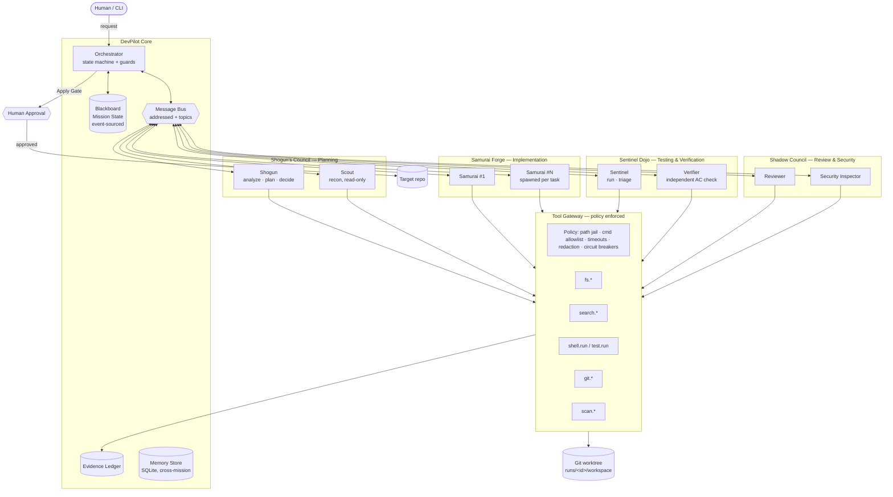
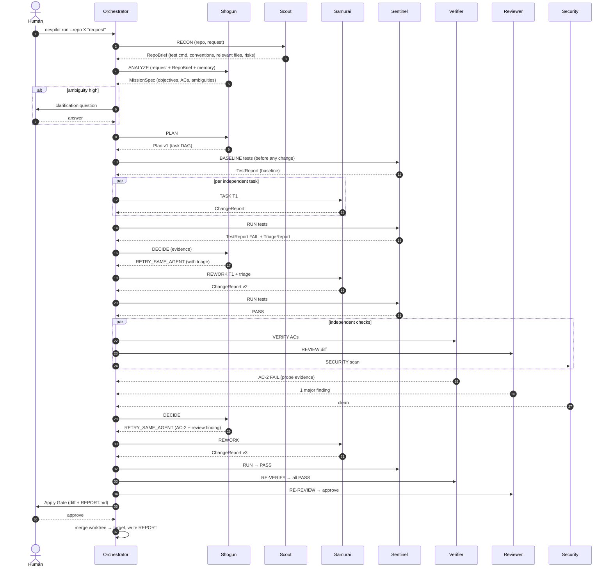

# 02 — Architecture

## 1. System overview



### Layers

| Layer | Responsibility | Deterministic? |
|---|---|---|
| **Orchestrator** | Mission lifecycle state machine, scheduling, budgets, gates, spawning agents | Yes (pure Python) |
| **Blackboard** | Single source of truth: spec, plan, tasks, findings, decisions, issues | Yes |
| **Message Bus** | Addressed agent-to-agent messages + topic broadcasts | Yes |
| **Agents** | LLM tool-use loops with role prompts, role-scoped tools, and typed terminal "submit" tools | No (LLM) |
| **Tool Gateway** | The *only* path to the filesystem/shell; enforces policy; writes evidence | Yes |
| **Evidence Ledger** | Immutable records of real tool executions (hashes, exit codes, logs) | Yes |
| **Report Renderer** | Builds final report from ledger + blackboard; decides VERIFIED status by rule | Yes |

> **Key principle:** the LLM proposes; deterministic code disposes. LLMs pick actions and write code, but cannot mark anything verified, cannot bypass policy, and cannot exceed budgets.

---

## 2. Architecture Decision Records (ADRs)

### ADR-001 — Python 3.11 + asyncio, no heavyweight agent framework
- **Decision:** Build a thin orchestrator (~1.5k LOC) on the Anthropic Python SDK's Messages API with tool use.
- **Why:** Judges score *our* coordination design. Frameworks (LangGraph, CrewAI, AutoGen) hide control flow and make bounded autonomy and evidence tracing harder to show. asyncio gives us real parallelism for free.
- **Consequence:** We own the agent loop (≈150 LOC). Acceptable.

### ADR-002 — Hybrid Blackboard + Message Bus
- **Decision:** Shared state lives on an event-sourced blackboard; agents communicate via addressed, typed messages that **reference blackboard records and evidence IDs**.
- **Why:** Blackboard alone = no dialogue (critique/dispute). Bus alone = no shared truth. Hybrid gives both, and events give a full audit log.

### ADR-003 — Orchestrator = state machine; Shogun = bounded decision-maker
- **Decision:** Lifecycle transitions and guards are code. At *decision points* (test failed, review blocked, task stuck, new info) the Shogun LLM chooses one action from an enum (`CONTINUE`, `RETRY_SAME_AGENT`, `REASSIGN`, `INVESTIGATE`, `REPLAN`, `ASK_HUMAN`, `STOP_PARTIAL`, `ABORT`) with a justification citing evidence IDs. Guards may veto (e.g., budget exhausted → forced `STOP_PARTIAL`).
- **Why:** Adaptive (not a fixed pipeline) *and* provably bounded.

### ADR-004 — Isolation via git worktree
- **Decision:** Each mission works in `runs/<mission_id>/workspace`, a `git worktree` on branch `devpilot/<mission_id>`. Non-git targets are copied and `git init`ed (shadow repo). The target is modified only by `apply` after human approval (fast-forward merge or `git apply` of the final diff).
- **Why:** Zero-risk to the user's repo; trivially reversible; diff is the natural review artifact.

### ADR-005 — Independent verification with information hiding
- **Decision:** The Verifier receives only: acceptance criteria, `RepoBrief`, final diff, and tools. It never receives Samurai's reasoning or self-assessment. It may write **probe tests** in `runs/<id>/probes/` (outside the workspace; never merged).
- **Why:** Prevents "grading your own homework" and confirmation bias.

### ADR-006 — Evidence Ledger and rule-based completion
- **Decision:** An acceptance criterion is `VERIFIED` iff it has ≥1 evidence record of kind `test_run` or `probe_run` with `exit_code == 0` **produced after the last code change**, and the Verifier's verdict for it is `PASS`. Anything else is `FAILED`, `UNVERIFIED`, or `CLAIMED` (LLM-asserted only).
- **Why:** Directly satisfies "must not claim success without evidence" and "separate verified outcomes from model claims".

### ADR-007 — Deterministic scanners before LLM security review
- **Decision:** Security Inspector runs built-in regex secret scanner + `bandit` (if installed) + `semgrep` (optional) first, then LLM reviews diff + scanner output. Missing scanners degrade gracefully (circuit breaker → fallback).
- **Why:** Scanners are reliable and explainable; LLM adds context (e.g., injection through string formatting the regex misses).

### ADR-011 — Parallelism with file-ownership locks
- **Decision:** Tasks form a DAG. Independent tasks whose `files_to_touch` sets are disjoint run on parallel Samurai instances. Reviewer, Security, and Verifier run concurrently after tests pass.
- **Why:** Bonus points; real speedup; locks prevent edit conflicts.

### ADR-008 — Model tiering + record/replay
- **Decision:** `claude-opus-5-5` for Shogun and Verifier (judgement-heavy, low volume); `claude-sonnet-5-5` for Scout, Samurai, Sentinel, Reviewer, Security; `claude-haiku-5-5` for summarisation/truncation helpers. All configurable. LLM I/O is recorded to `runs/<id>/cassette.jsonl`; `--replay` replays LLM responses while **re-executing all tools for real**.
- **Why:** Quality where it matters, cost where it doesn't; reproducible demo.

### ADR-009 — Structured outputs via terminal tools
- **Decision:** Each agent finishes by calling a role-specific `submit_*` tool whose JSON schema is the agent's output contract (e.g., `submit_plan`, `submit_change`, `submit_verdict`). The loop ends only on a valid submit or budget exhaustion.
- **Why:** Typed, validated (pydantic) handoffs between agents. No regex-parsing prose.

### ADR-010 — Web Mission Control as primary UI (revised)
- **Decision:** A React Mission Control app (live Guild Graph, trace waterfall, Monaco diff with finding annotations, test heatmap, time-travel scrubber, human-gate modals), streamed over WebSocket with JSON-Patch state sync. The `typer` + `rich` CLI stays for scripting and eval. Spec: `12-MISSION-CONTROL-UI.md`.
- **Why:** Transparency and human oversight are judged criteria. A visual, inspectable, time-travelling view of agent coordination is the strongest way to show them.

> **Note:** `11-ADVANCED-ENGINE.md` extends and supersedes parts of this document (modes, model tiers, tournaments, spec-first testing, advanced verification).

---

## 3. Agent roster (summary — details in `03-AGENTS.md`)

| Agent | Guild | Instances | Writes code? | Model | Primary output |
|---|---|---|---|---|---|
| **Shogun** | Council | 1 | No | opus | `MissionSpec`, `Plan`, `Decision` |
| **Scout** | Council | 1..N (on demand) | No | sonnet | `RepoBrief`, `InvestigationReport` |
| **Samurai** | Forge | 1..N (dynamic) | **Yes** (workspace only) | sonnet | `ChangeReport` |
| **Sentinel** | Dojo | 1 | No (runs tests) | sonnet | `TestReport`, `TriageReport` |
| **Verifier** | Dojo | 1 | Probes only (outside workspace) | opus | `VerifierVerdict` |
| **Reviewer** | Shadow | 1 | No | sonnet | `ReviewReport` |
| **Security Inspector** | Shadow | 1 | No | sonnet | `SecurityReport` |
| **Human** | — | 1 | Approves | — | `HumanDecision` |

Why 7 roles and not fewer: each role either has **different permissions** (least privilege) or **must have independent context** (verification/review). We did not split roles that would share both permissions and context.

---

## 4. End-to-end mission flow (happy path + loops)



---

## 5. Deployment & runtime view

```
devpilot run
   │
   ├── creates runs/<mission_id>/
   │      ├── workspace/          git worktree (agents' sandbox)
   │      ├── probes/             verifier probe tests (never merged)
   │      ├── evidence/           raw logs: E-0001.log, E-0002.junit.xml ...
   │      ├── events.jsonl        append-only event log (source of truth)
   │      ├── state.sqlite        projection of events (fast queries)
   │      ├── cassette.jsonl      LLM request/response recording
   │      ├── final.diff
   │      ├── REPORT.md / report.html
   │      └── mission.json        final snapshot
   └── ~/.devpilot/memory.sqlite  cross-mission memory
```

Concurrency: one asyncio event loop; each agent run is a task; `asyncio.Semaphore(llm_concurrency=3)` around LLM calls; `asyncio.Semaphore(1)` per test-run (tests are serialised in a workspace to avoid interference); file-ownership locks per path.
