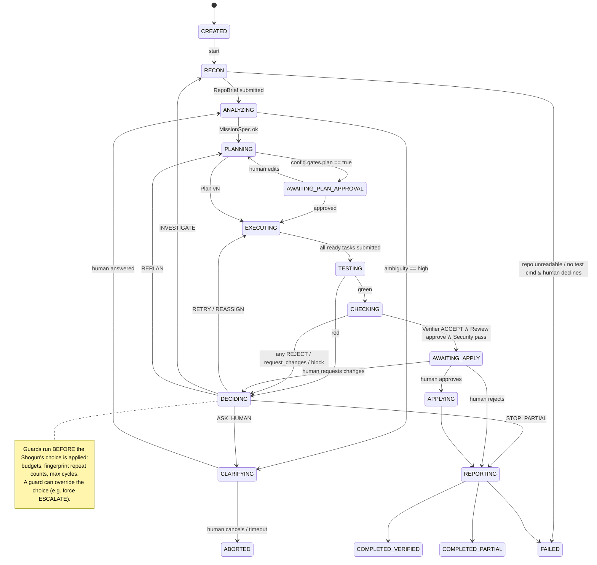
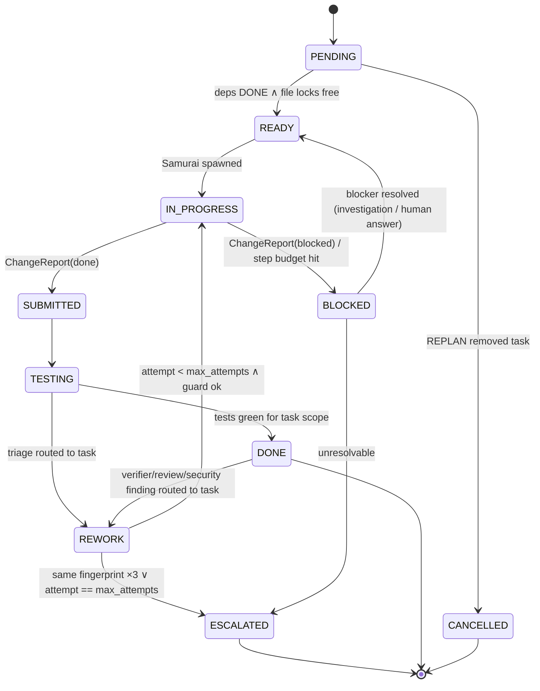
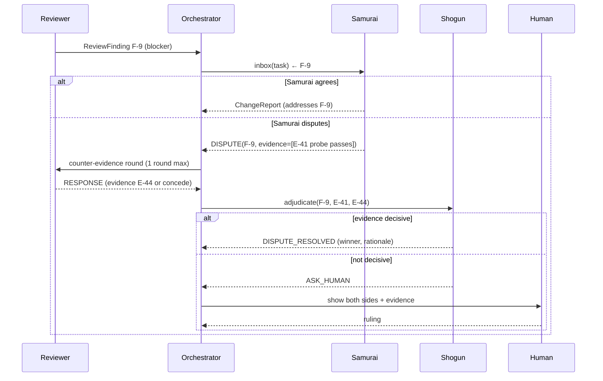

# 04 — Orchestration, Shared State & Communication

## 1. Mission lifecycle state machine



Any state → `ABORTED` on `Ctrl-C` / `devpilot abort`; any state → `REPORTING` on global budget exhaustion. **Every terminal state produces a report.**

### Terminal outcome rules (deterministic)

| Outcome | Condition |
|---|---|
| `COMPLETED_VERIFIED` | All ACs `VERIFIED` (ADR-006), no regressions, review approve, security pass, human approved & applied |
| `COMPLETED_PARTIAL` | Some ACs verified, others failed/unverified; or human rejected apply; or stopped on budget with useful progress |
| `FAILED` | No AC verified, or baseline unrecoverable |
| `ABORTED` | Human cancelled |

---

## 2. Task state machine



---

## 3. Shared Mission State (Blackboard) — schema

Event-sourced: `events.jsonl` is truth; `state.sqlite` and the in-memory `Mission` object are projections. Writes go through `Blackboard.apply(event)`; each record type has **one owner role**.

```python
# devpilot/core/models.py
class AcceptanceCriterion(BaseModel):
    id: str                                # "AC-1"
    text: str                              # "Cart.total() applies a SAVE10 code as 10% off"
    verification_method: Literal["existing_test","new_test","probe","static_check","manual"]
    status: Literal["PENDING","VERIFIED","FAILED","UNVERIFIED","CLAIMED"] = "PENDING"
    evidence_ids: list[str] = []
    owner: Literal["shogun"] = "shogun"

class MissionSpec(BaseModel):
    request: str
    objectives: list[str]
    acceptance_criteria: list[AcceptanceCriterion]
    non_goals: list[str]
    assumptions: list[str]
    ambiguity: Ambiguity                   # {level: low|medium|high, question?, options?}
    constraints: list[str]                 # "do not change public API of Cart"

class Task(BaseModel):
    id: str                                # "T1"
    title: str
    description: str
    acceptance_refs: list[str]             # ["AC-1","AC-3"]
    files_to_touch: list[str]              # used for parallel-safety locks
    depends_on: list[str] = []
    may_edit_tests: bool = False
    assignee: str | None = None            # "samurai#2"
    status: TaskStatus = "PENDING"
    attempts: list[Attempt] = []           # {n, change_report_id, fingerprints[], outcome}

class Plan(BaseModel):
    version: int
    rationale: str
    tasks: list[Task]
    revised_because: str | None = None     # set on v2+, cites evidence/finding IDs

class Finding(BaseModel):                  # unified record for triage/review/security/investigation
    id: str                                # "F-0007"
    source_agent: str
    kind: Literal["triage","review","security","investigation","verifier"]
    severity: str
    summary: str
    detail: dict
    routed_to: str | None                  # task id / agent id
    status: Literal["open","addressed","disputed","wontfix","escalated"]
    evidence_ids: list[str]

class Decision(BaseModel):
    id: str
    trigger_event_id: str
    action: Literal["CONTINUE","RETRY_SAME_AGENT","REASSIGN","INVESTIGATE","REPLAN",
                    "ASK_HUMAN","STOP_PARTIAL","ABORT"]
    target: str | None                     # task id
    justification: str
    cited_evidence: list[str]
    overridden_by_guard: str | None = None # e.g. "fingerprint_repeat>=3 → ASK_HUMAN"

class Issue(BaseModel):                    # open questions / unresolved items
    id: str; text: str; raised_by: str; status: Literal["open","resolved","escalated"]

class Mission(BaseModel):
    id: str                                # "M-20261030-1432-a1b2"
    status: MissionStatus
    repo_path: str
    workspace_path: str
    spec: MissionSpec | None
    repo_brief: RepoBrief | None
    plans: list[Plan]                      # full history; current = plans[-1]
    findings: list[Finding]
    decisions: list[Decision]
    issues: list[Issue]
    evidence: list[EvidenceRef]
    counters: Counters                     # fix_cycles, llm_tokens, tool_calls, wall_clock_s
    budgets: Budgets
    human_decisions: list[HumanDecision]
```

### Ownership table

| Record | Writer | Readers |
|---|---|---|
| `spec`, `plans`, `decisions` | Shogun (via orchestrator) | all (Verifier: spec only) |
| `repo_brief` | Scout | all |
| `tasks[*].attempts` | Orchestrator (from Samurai `ChangeReport`) | all except Verifier |
| `findings(kind=triage)` | Sentinel | Shogun, Samurai, Reviewer |
| `findings(kind=review/security)` | Reviewer / Security | Shogun, Samurai |
| `findings(kind=verifier)` / AC status | Verifier + Report rule engine | all |
| `evidence` | **Tool Gateway only** | all |
| `human_decisions` | Human Gate | all |

---

## 4. Message bus

```python
class AgentMessage(BaseModel):
    id: str                                 # "MSG-0042"
    mission_id: str
    sender: str                             # "sentinel", "samurai#2"
    to: str                                 # agent id | task id ("task:T2") | topic ("topic:review")
    type: Literal["FINDING","REQUEST","RESPONSE","HANDOFF","VERDICT","DISPUTE",
                  "DISPUTE_RESOLVED","ESCALATION","INFO"]
    in_reply_to: str | None = None
    subject: str
    body: str                               # concise natural language
    refs: list[str] = []                    # finding IDs, AC IDs, task IDs
    evidence_ids: list[str] = []
    ts: datetime
```

**Delivery semantics**
- Messages addressed to `task:Tn` are queued in that task's **inbox** and injected into the next Samurai briefing for that task (as a "Messages for you" section). This is how feedback changes the next action.
- `REQUEST` messages are converted by the orchestrator into a scheduled agent invocation (e.g., Samurai asks a question → Scout investigation) and the result is returned as `RESPONSE`.
- Every message is also an event (`MESSAGE_SENT`) → visible in the live view and report.

---

## 5. Event log

Every state change is an event. Example lines from `events.jsonl`:

```json
{"seq":41,"ts":"2026-10-30T14:33:02Z","type":"TOOL_CALL","agent":"samurai#1","task":"T1","tool":"fs.edit","args":{"path":"src/pager.py"},"evidence_id":"E-0019","ok":true}
{"seq":44,"ts":"2026-10-30T14:33:20Z","type":"TEST_RUN","agent":"sentinel","evidence_id":"E-0021","exit_code":1,"totals":{"passed":11,"failed":1}}
{"seq":45,"ts":"2026-10-30T14:33:31Z","type":"FINDING","id":"F-0003","kind":"triage","routed_to":"task:T1","fingerprint":"a91f03","summary":"last page empty when total % size == 0"}
{"seq":46,"ts":"2026-10-30T14:33:39Z","type":"DECISION","id":"D-0004","action":"RETRY_SAME_AGENT","target":"T1","cited_evidence":["E-0021"],"justification":"New, specific triage; first occurrence of fingerprint a91f03"}
```

Event types: `MISSION_CREATED, STATE_CHANGED, SPEC_SUBMITTED, PLAN_SUBMITTED, PLAN_REVISED, TASK_STATE_CHANGED, AGENT_SPAWNED, AGENT_THOUGHT, TOOL_CALL, POLICY_DENIED, TOOL_UNAVAILABLE, TEST_RUN, FINDING, MESSAGE_SENT, DECISION, GUARD_OVERRIDE, STRATEGY_CHANGED, DISPUTE, DISPUTE_RESOLVED, HUMAN_PROMPT, HUMAN_DECISION, BUDGET_WARNING, BUDGET_EXCEEDED, APPLIED, REPORT_WRITTEN`.

---

## 6. Adaptive orchestration & bounded autonomy

### 6.1 Decision points
The orchestrator calls `Shogun.decide()` when any of these occur:
`TEST_RED`, `VERIFIER_REJECT`, `REVIEW_REQUEST_CHANGES`, `SECURITY_BLOCK`, `TASK_BLOCKED`, `DISPUTE_RAISED`, `INVESTIGATION_RESULT`, `HUMAN_REQUESTED_CHANGES`.

### 6.2 Failure fingerprinting
```python
def fingerprint(err: str) -> str:
    s = re.sub(r'File ".*?"', 'File "<p>"', err)          # paths
    s = re.sub(r'line \d+', 'line N', s)                   # line numbers
    s = re.sub(r'0x[0-9a-f]+', '0xADDR', s)                # addresses
    s = re.sub(r'\d+\.\d+s', 'Ts', s)                      # timings
    key = (exception_type(s), failing_nodeid(s), last_frame_func(s), first_assert_line(s))
    return sha1("|".join(key).encode()).hexdigest()[:8]
```
Progress signal = set of failing fingerprints shrinks or changes. Same set twice = **no progress**.

### 6.3 Guards (code, run after Shogun chooses — can override)

| Guard | Condition | Forced action |
|---|---|---|
| `repeat_fingerprint_2` | Task's latest fingerprint seen 2× | Disallow `RETRY_SAME_AGENT` → must be `INVESTIGATE`/`REASSIGN`/`REPLAN`; emits `STRATEGY_CHANGED` |
| `repeat_fingerprint_3` | Seen 3× | `ASK_HUMAN` (task → ESCALATED) |
| `max_attempts` | `task.attempts ≥ budgets.max_attempts_per_task` (3) | `ASK_HUMAN` |
| `max_fix_cycles` | `counters.fix_cycles ≥ budgets.max_fix_cycles` (6) | `STOP_PARTIAL` |
| `max_replans` | `len(plans) > budgets.max_replans + 1` (2) | `ASK_HUMAN` |
| `token_budget` | `llm_tokens ≥ 90%` | warn; at 100% → `STOP_PARTIAL` |
| `wall_clock` | `> budgets.max_wall_clock_s` (1200) | `STOP_PARTIAL` |
| `tool_circuit_open` | tool failed 3× consecutively | tool disabled for mission; agents told to use fallback |
| `env_failure` | triage `is_environmental` ∧ repeat | `ASK_HUMAN` (don't burn cycles on env) |
| `stale_verdict` | diff_sha changed after verdict | re-run CHECKING before AWAITING_APPLY |

### 6.4 Decision policy (guidance given to Shogun; guards enforce the hard parts)

| Situation | Preferred action |
|---|---|
| First failure, high-confidence triage | `RETRY_SAME_AGENT` with triage in inbox |
| Repeat fingerprint or low-confidence triage | `INVESTIGATE` (Scout reads wider context, e.g. callers/config) → then retry with new hypothesis |
| Investigation reveals new scope (other module, missing dependency) | `REPLAN` (add/modify tasks; plan v+1 with `revised_because`) |
| Samurai blocked by missing info only the user has | `ASK_HUMAN` |
| Samurai disputes a test/review finding | `adjudicate`: evidence wins; otherwise `ASK_HUMAN` |
| Environmental failure (dep missing, network) | `ASK_HUMAN` with exact command the human may run |
| Partial ACs verified, budget nearly gone | `STOP_PARTIAL` |

### 6.5 Budgets config

```toml
[budgets]
max_attempts_per_task = 3
max_fix_cycles        = 6       # test→fix loops across the mission
max_replans           = 2
max_agent_steps       = 25      # tool-use iterations per agent invocation
max_tokens_mission    = 600_000
max_wall_clock_s      = 1200
tool_timeout_s        = 120
llm_concurrency       = 3
max_parallel_samurai  = 3
```

---

## 7. Dispute protocol (cross-agent critique)


Rules: max 1 counter-evidence round; claims without evidence lose to claims with evidence; ties → human.

---

## 8. Parallel scheduling

```python
async def execute_ready_tasks(mission):
    ready = [t for t in plan.tasks if t.status == "READY"]
    batch, claimed = [], set()
    for t in ready:                                   # greedy disjoint-file batching
        if claimed.isdisjoint(t.files_to_touch) and len(batch) < budgets.max_parallel_samurai:
            batch.append(t); claimed |= set(t.files_to_touch)
    await asyncio.gather(*(spawn_samurai(t) for t in batch))
```
If a Samurai needs to edit a file outside its `files_to_touch` and that file is locked by another task, the edit is denied with `LOCKED_BY T2`; the Samurai may request a lock extension (orchestrator grants if free) or report `blocked`.

Post-green checks run in parallel: `await asyncio.gather(verifier(), reviewer(), security())`.

---

## 9. Persistent memory

`~/.devpilot/memory.sqlite`, keyed by repo fingerprint (`sha1(remote_url or abs_path)`):

```sql
CREATE TABLE memory (
  id INTEGER PRIMARY KEY,
  repo_key TEXT NOT NULL,
  kind TEXT CHECK(kind IN ('convention','test_command','pitfall','lesson','human_preference')),
  content TEXT NOT NULL,
  source_mission TEXT,
  evidence_id TEXT,            -- memories are only written when backed by evidence
  confidence REAL DEFAULT 0.5,
  uses INTEGER DEFAULT 0,
  created_at TEXT, last_used_at TEXT
);
```
- **Write:** at REPORTING, a deterministic extractor stores the confirmed test command, conventions confirmed by Reviewer approval, and "lessons" = triage root causes that were fixed (fingerprint → fix summary).
- **Read:** `memory.recall(query)` returns top-k by keyword match + `confidence`; injected into Scout/Shogun/Samurai briefings, labelled *"memory (may be stale)"*.
