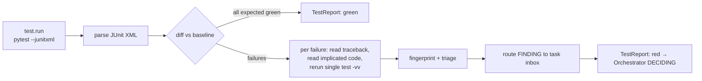

# 06 — Testing, Verification & Evidence-Based Completion

## 1. Three layers of checking (each independent of the last)

| Layer | Who | Question answered | Context |
|---|---|---|---|
| Self-check | Samurai | "Did my change make the targeted tests pass?" | Full task context — **counts as a claim**, not evidence of completion |
| Suite run + triage | Sentinel | "What is the state of *all* tests vs. baseline? Why did anything fail?" | Diff + test output; owns test evidence |
| Acceptance verification | Verifier | "Is each acceptance criterion demonstrably satisfied on the final code?" | **Isolated**: spec + diff + brief only; writes probe tests |

## 2. Baseline first
Before any edit, Sentinel runs the suite on the untouched workspace → `baseline` evidence. This makes it possible to:
- Distinguish **regressions** (passed at baseline, fails now) from **pre-existing failures**.
- Handle the *Test-Driven Recovery* scenario: the baseline red test *is* the objective.
- Never blame the agent for pre-existing failures (and never hide them — they appear in the report).

## 3. Test-run pipeline



Structured runner (Python): `python -m pytest -q --junitxml=<evidence>/E-xxxx.junit.xml -p no:cacheprovider`.
Parser output is deterministic; the LLM only writes the triage *hypothesis*.

Node support (detection only): if `package.json` has `scripts.test`, `test.run` executes `npm test -- --reporters=default` and parses exit code + stdout (no per-case breakdown).

## 4. The repair loop

```
attempt n:  Samurai(ChangeReport) → Sentinel(TestReport red, triage F)
            → Shogun.decide(trigger=TEST_RED, evidence=[E], history=[fingerprints])
            → guards
            → action ∈ {RETRY_SAME_AGENT(+triage), INVESTIGATE, REASSIGN, REPLAN, ASK_HUMAN, STOP_PARTIAL}
attempt n+1: Samurai briefing now contains:
            ## Messages for you
            - [Sentinel F-0003, evidence E-0021] test_last_page_partial fails:
              expected 3 items on page 4, got 0. Root cause hypothesis: integer division
              drops the remainder page (src/pager.py:L41). Confidence: high.
            ## Previous attempts
            - attempt 1: hypothesis "off-by-one in slice end" → fingerprint a91f03 (FAILED)
            You must not repeat a failed hypothesis.
```
This is the concrete mechanism by which **new evidence changes what an agent does next**.

## 5. Verifier details

### Probe test template (written by Verifier into `runs/<id>/probes/`)
```python
# probes/test_probe_AC_2.py — generated by Verifier for AC-2; NOT merged into the repo
import sys; sys.path.insert(0, r"{workspace}")
from shopcart.cart import Cart

def test_ac2_discount_never_negative():
    c = Cart(); c.add("pen", price=1.00, qty=1)
    c.apply_code("SAVE10")
    assert c.total() >= 0

def test_ac2_unknown_code_rejected():
    c = Cart()
    import pytest
    with pytest.raises(ValueError):
        c.apply_code("BOGUS")
```
Run via `test.run(selector="<probes path>", rootdir=workspace)` → evidence kind `probe_run`.

### Anti-gaming checks the Verifier performs
- A new test that asserts nothing / asserts `True` / mocks the unit under test → AC `INCONCLUSIVE` + finding.
- Existing test assertions changed in the diff → flagged to Reviewer and Human (even if allowed).
- Verdict bound to `diff_sha`; any later edit voids it.

## 6. Completion rules (Report engine — deterministic, no LLM)

```python
def ac_status(ac, ledger, verdicts, final_ws_sha) -> str:
    ev = [e for e in ledger.for_ac(ac.id) if e.workspace_sha == final_ws_sha]
    passing = [e for e in ev if e.kind in ("test_run", "probe_run") and e.exit_code == 0]
    v = verdicts.latest_for(ac.id, final_ws_sha)
    if passing and v and v.verdict == "PASS":   return "VERIFIED"
    if v and v.verdict == "FAIL":               return "FAILED"
    if ac.verification_method == "manual":      return "UNVERIFIED"   # needs human
    if ac.claimed_by_agent and not passing:     return "CLAIMED"
    return "UNVERIFIED"
```

## 7. Final report format (`runs/<id>/REPORT.md`)

```markdown
# DevPilot Mission Report — M-20261030-1432-a1b2
**Outcome:** COMPLETED_VERIFIED · **Applied:** yes (approved by human at 14:41:07)
**Request:** "Users report the last page of results is missing items."

## ✅ Verified (backed by test runs on final code, workspace_sha 3f9c2e1)
| AC | Criterion | Evidence |
|----|-----------|----------|
| AC-1 | Last page contains remaining items when total % size != 0 | E-0034 (pytest, 13 passed), E-0036 (probe) |
| AC-2 | page_count correct when total % size == 0 | E-0036 (probe) |
| AC-3 | All baseline-passing tests still pass | E-0034 |

## ❌ Failed / ⚠️ Unverified
_None._

## 🗣️ Model claims (NOT verified)
- Samurai: "Performance is unchanged" — no benchmark was run.

## 🔁 Feedback loops
1. E-0021 red → triage F-0003 → D-0004 RETRY → attempt 2 green (E-0027)
2. Verifier AC-2 FAIL (E-0029, counterexample total=20,size=5) → D-0006 RETRY → attempt 3 → E-0036 PASS

## 🔍 Review & Security
Reviewer: approve (1 minor fixed, 1 nit open). Security: pass (scan.secrets, bandit; semgrep unavailable).

## 📋 Plan history
v1 (1 task) → no revisions.

## 🧾 Changed files
src/pager.py (+4 −2), tests/test_pager.py (+18)

## ⏱️ Budget usage
fix_cycles 2/6 · tokens 148k/600k · wall clock 6m12s · tool calls 61

## Pre-existing issues (not addressed)
- tests/test_export.py::test_csv_unicode failing at baseline (E-0003) — out of scope.
```

Also emitted: `report.html` (same data + collapsible event timeline + diff viewer), `mission.json` (machine-readable).
