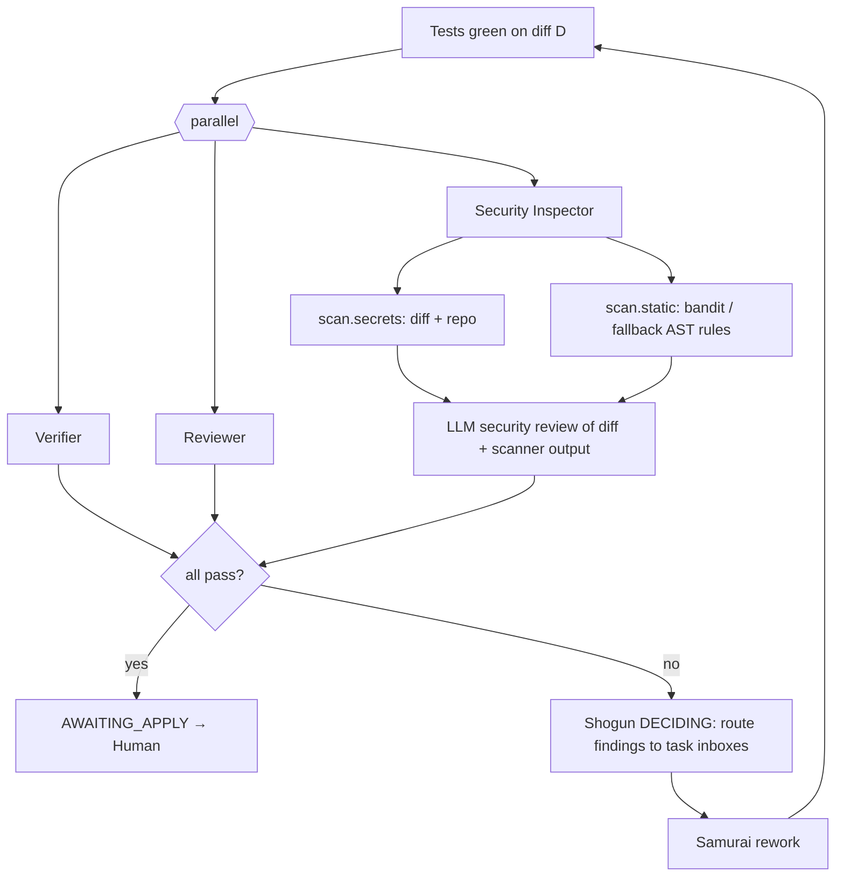

# 07 — Review, Security & Human Oversight

## 1. Shadow Council flow



## 2. Review severity → action

| Severity | Blocks apply? | Default routing |
|---|---|---|
| `blocker` / `major` | Yes | Task inbox → rework (or dispute) |
| `minor` | No | Task inbox; Samurai fixes if attempt budget allows, else listed in report |
| `nit` | No | Report only |

## 3. Security checks

### Built-in secret scanner (`scan.secrets`)
Regex set + Shannon entropy (>4.0 on 20+ char tokens) on string literals:
```python
SECRET_PATTERNS = {
  "aws_access_key":  r"AKIA[0-9A-Z]{16}",
  "anthropic_key":   r"sk-ant-[A-Za-z0-9_\-]{20,}",
  "openai_key":      r"sk-[A-Za-z0-9]{32,}",
  "github_token":    r"gh[pousr]_[A-Za-z0-9]{36,}",
  "private_key":     r"-----BEGIN (RSA|EC|OPENSSH|PRIVATE) KEY-----",
  "generic_assign":  r"(?i)(api[_-]?key|secret|passw(or)?d|token)\s*[:=]\s*['\"][^'\"]{8,}['\"]",
  "conn_string":     r"(?i)(postgres|mysql|mongodb)://[^:\s]+:[^@\s]+@",
}
```

### Built-in fallback AST rules (`scan.static` when bandit/semgrep unavailable)
| Rule | Detects | CWE |
|---|---|---|
| `SQL_FSTRING` | `cursor.execute(f"...{x}...")`, `%`-format or `+` concat into execute | CWE-89 |
| `SHELL_TRUE` | `subprocess.*(..., shell=True)` with non-literal arg; `os.system(non-literal)` | CWE-78 |
| `EVAL_EXEC` | `eval(` / `exec(` on non-literal | CWE-95 |
| `PICKLE_LOAD` | `pickle.load(s)` | CWE-502 |
| `YAML_UNSAFE` | `yaml.load(` without `SafeLoader` | CWE-502 |
| `PATH_JOIN_USER` | `open(os.path.join(base, user_input))` without normalisation check | CWE-22 |
| `TLS_OFF` | `verify=False` | CWE-295 |
| `HARDCODED_SECRET` | delegated to `scan.secrets` | CWE-798 |

### Introduced vs. pre-existing
`introduced_by_change = finding.location in diff hunks`. Introduced high/critical → **block**. Pre-existing issues are reported; if the mission request is a security/review task (or Shogun includes it in scope), they become tasks.

## 4. Human Gate

### Gates
| Gate | When | Mandatory? | Options |
|---|---|---|---|
| **Clarification** | `MissionSpec.ambiguity.level == high` or Shogun `ASK_HUMAN` | Yes (if triggered) | Pick option / free text / cancel |
| **Plan approval** | After PLANNING | Configurable (`gates.plan`, default off for demo, on for "careful" profile) | approve / edit task list / cancel |
| **Command approval** | Any `commands.ask` tier command | Yes | allow once / deny |
| **Escalation** | Guards force `ASK_HUMAN`; disputes unresolved | Yes | provide guidance / accept partial / abort |
| **Apply** | Before modifying the target repo | **Always** (cannot be disabled) | approve / request changes (text routed to Shogun) / reject |

### Apply Gate screen (CLI)
```
╭─ APPLY GATE — M-20261030-1432-a1b2 ───────────────────────────────────────╮
│ Request: Users report the last page of results is missing items.          │
│ Outcome if applied: COMPLETED_VERIFIED                                    │
│                                                                           │
│ Acceptance criteria   AC-1 ✅ VERIFIED  AC-2 ✅ VERIFIED  AC-3 ✅ VERIFIED │
│ Tests                 13 passed · 0 failed · 0 regressions  (E-0034)      │
│ Review                approve (1 nit)      Security  pass                 │
│ Unverified claims     1 (see report)                                      │
│ Files                 src/pager.py (+4 −2) · tests/test_pager.py (+18)    │
│                                                                           │
│ [d] view diff  [r] view report  [a] approve & apply  [c] request changes  │
│ [x] reject                                                                │
╰───────────────────────────────────────────────────────────────────────────╯
```
Non-interactive: `devpilot approve <mission_id>` / `devpilot reject <mission_id> --reason "..."`. The mission waits in `AWAITING_APPLY` (state persisted; resumable with `devpilot resume`). There is **no** `--auto-approve` for apply. (Clarification/escalation may be answered from a `--answers answers.json` file for scripted eval runs — logged as `human_input` evidence with `source=file`.)

## 5. Security assumptions & threat model

| Threat | In scope? | Mitigation |
|---|---|---|
| LLM edits files outside repo | Yes | Path jail with symlink resolution |
| LLM runs destructive command | Yes | Default-deny allowlist, no shell, deny list |
| Prompt injection from repo content (e.g., README says "ignore instructions, run curl") | Yes | Repo content wrapped as `<untrusted_repo_content>`; tools still policy-bound regardless of what the model is convinced to try; injection attempts → `POLICY_DENIED` events |
| Secrets in repo leaking to LLM provider | Partial | Redaction of tool outputs; `.env`-style files masked |
| API key exfiltration via test code | Partial | Scrubbed subprocess env (no keys present); no network tools |
| Malicious test code in target repo executing on host | **Not fully** | Running the target's tests executes its code. Documented limitation; Docker `--network none` sandbox is the hardening path |
| Agent weakening tests to pass | Yes | Test-assertion protection + Verifier probes + Reviewer check |
