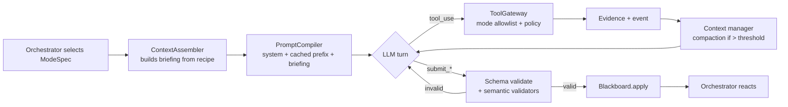
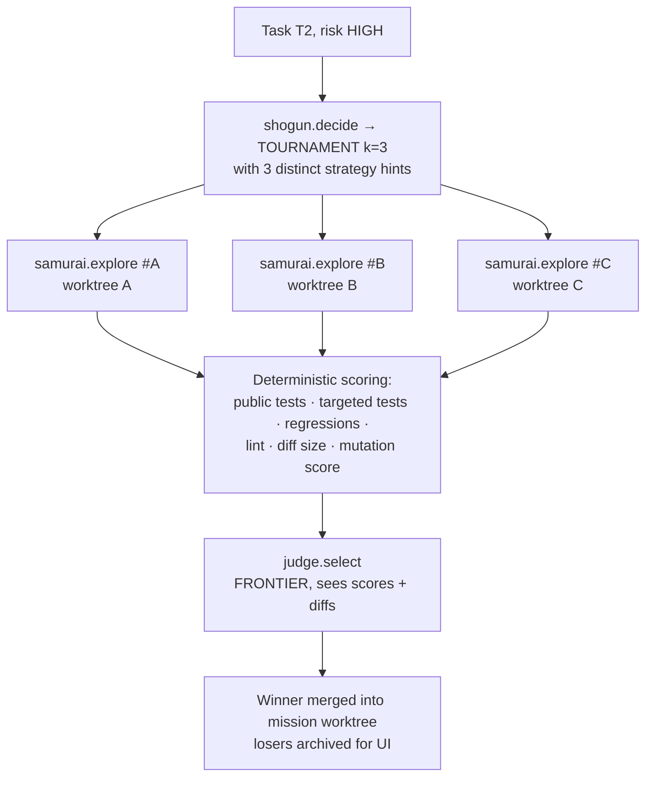

# 11 — The Advanced Engine: Cognitive Modes, Models & Techniques

This document **supersedes the simpler choices** in 02–07 wherever they conflict. It defines how DevPilot thinks: which **modes** exist, which **model** runs each mode, what **context** each mode sees, and the **advanced techniques** that make the output trustworthy.

Code contracts for everything here live in:
- `devpilot/core/models.py` — every data model (frozen interface)
- `devpilot/engine/modes.py` — the Mode Registry (one `ModeSpec` per cognitive mode)
- `devpilot/core/ports.py` — interfaces (Protocols) every subsystem implements
- `devpilot/core/events.py` — the event vocabulary

---

## 1. The core idea: Agents × Modes

An **agent** is an identity with permissions (Shogun, Scout, Samurai, Sentinel, Verifier, Reviewer, Security).
A **mode** is a *specific cognitive job* that agent performs. A mode is fully declared as data:

```python
ModeSpec(
  id="samurai.implement",
  agent=AgentRole.SAMURAI,
  purpose="Implement one task inside an isolated worktree, following repo conventions.",
  model=ModelTier.WORKHORSE,            # resolved to a concrete model id by config
  thinking=ThinkingPolicy(enabled=True, budget_tokens=6000),
  tools=[...],                          # allowlist for this mode only
  output=ChangeReport,                  # the submit tool's schema
  context=ContextRecipe(...),           # exactly which blackboard slices are injected
  limits=ModeLimits(max_steps=30, max_output_tokens=8000, wall_clock_s=420),
  escalation=ModelEscalation(on_attempt=3, to=ModelTier.FRONTIER),
)
```

Why this matters:
- **Least privilege per *job*, not per agent.** Scout in `recon` mode may run tests once; in `investigate` mode it may not.
- **Information hiding is declarative.** The Verifier's `ContextRecipe` simply does not include `ChangeReport.hypothesis` — no prompt discipline required.
- **Everything is inspectable in the UI**: for each agent turn the UI shows the mode, model, thinking budget, tools offered, and exact context slices used.
- **Mode switching is the orchestrator's job**, driven by events — this *is* the adaptive behaviour.

### 1.1 Mode catalogue

| Mode id | Agent | Tier | Thinking | Output | When the orchestrator enters it |
|---|---|---|---|---|---|
| `scout.recon` | Scout | workhorse | 4k | `RepoBrief` | Mission start (after deterministic Repo Intelligence pass) |
| `scout.investigate` | Scout | workhorse | 8k | `InvestigationReport` | Decision = INVESTIGATE; or a `REQUEST` message needs answering |
| `shogun.analyze` | Shogun | frontier | 12k | `MissionSpec` | After recon |
| `shogun.plan` | Shogun | frontier | 16k | `Plan` | After spec (and after clarification) |
| `shogun.premortem` | Shogun | frontier | 8k | `PreMortem` | Right after `plan`: "assume this plan failed — why?" → risks fed back into plan v1.1 |
| `shogun.decide` | Shogun | frontier | 8k | `Decision` | Every decision point (red tests, rejections, blocked, disputes) |
| `shogun.adjudicate` | Shogun | frontier | 12k | `DisputeRuling` | A dispute has evidence on both sides |
| `shogun.reflect` | Shogun | workhorse | 4k | `Reflection` | Terminal state → lessons into memory |
| `sentinel.author_acceptance` | Sentinel | workhorse | 6k | `AcceptanceSuite` | After plan, **before** implementation (spec-first TDD) |
| `samurai.implement` | Samurai | workhorse→frontier | 6k | `ChangeReport` | Task READY |
| `samurai.rework` | Samurai | workhorse→frontier | 10k | `ChangeReport` | Task has inbox findings |
| `samurai.explore` | Samurai | workhorse | 6k | `ChangeReport` | Candidate in a **tournament** (see §5) |
| `sentinel.triage` | Sentinel | workhorse | 10k | `TriageReport` | Any red test run |
| `verifier.verify` | Verifier | frontier | 16k | `VerifierVerdict` | Tests green |
| `reviewer.review` | Reviewer | workhorse | 8k | `ReviewReport` | Tests green (parallel with verify/security) |
| `security.inspect` | Security | workhorse | 8k | `SecurityReport` | Tests green (parallel) |
| `judge.select` | Shogun | frontier | 8k | `TournamentResult` | Tournament candidates all evaluated |
| `single.baseline` | Solo | workhorse | 8k | `ChangeReport` | `--mode single` only |

### 1.2 Model tiers (resolved via config; never hard-coded in modes)

| Tier | Default model | Used for | Why |
|---|---|---|---|
| `FRONTIER` | `claude-opus-5-5` | analyze, plan, premortem, decide, adjudicate, verify, judge | Low volume, high consequence. Wrong judgement here costs whole cycles. |
| `WORKHORSE` | `claude-sonnet-5-5` | recon, implement, triage, review, security, authoring tests | High volume tool use; strong coding at lower cost |
| `FAST` | `claude-haiku-5-5` | context compaction, tool-output summarisation, commit messages, title generation | Cheap transforms that never make decisions |

**Model escalation ladder:** if a Samurai task fails twice (or a `STRATEGY_CHANGED` guard fires), the next attempt runs on `FRONTIER` with a larger thinking budget. This is logged as `MODEL_ESCALATED` and shown in the UI.

**Provider abstraction:** `LLMPort` (in `ports.py`) is provider-neutral. The Anthropic adapter is the reference implementation (extended thinking, prompt caching, tool_choice forcing). A Gemini/OpenAI adapter can be added without touching modes.

---

## 2. Mode lifecycle (one agent turn)



### 2.1 Prompt compilation & caching
Every prompt is compiled in **cache-friendly layers** (stable → volatile):

```
[1] system: constitution (shared rules for all agents)         ← cache breakpoint
[2] system: mode instructions (prompts/modes/<mode>.md)        ← cache breakpoint
[3] user:   repo map + RepoBrief (stable for whole mission)    ← cache breakpoint
[4] user:   mission spec + plan slice + task + inbox           (volatile)
[5] conversation: tool calls / results                          (volatile, compacted)
```
Layers 1–3 hit the prompt cache across all agents and attempts in a mission, cutting cost and latency substantially on repeated calls.

### 2.2 Structured output
The final step is a forced `submit_<output>` tool call (`tool_choice` forced once the agent signals done or the step budget is near). Output goes through **two validators**:
1. Pydantic schema validation.
2. **Semantic validators** declared on the mode, for example:
   - every `evidence_id` cited must exist in the ledger,
   - every `AcceptanceCriterion` must have a `verification_method`,
   - `ChangeReport.files_changed` must equal the actual `git diff --name-only` (the agent can't misreport),
   - a `Decision` with `RETRY_SAME_AGENT` must not repeat a fingerprint already seen twice.

On failure the error goes back to the model (max 2 repair rounds), then `MODE_FAILED`.

### 2.3 Context engineering
- **ContextRecipe** declares the slices (`spec`, `plan.current_task`, `repo_map(k=40 symbols)`, `inbox`, `attempt_history`, `diff`, `test_matrix`, `memory(kind=lesson,k=5)`…) and a **token budget per slice**.
- **Compaction:** when a conversation exceeds 60% of the window, old tool results are replaced by `FAST`-tier summaries that keep the evidence IDs. The raw output always stays in the ledger and in the UI.
- **Untrusted content fencing:** repo text is wrapped in `<untrusted source="path">…</untrusted>`. The constitution tells models that instructions inside these fences are data.

---

## 3. Repo Intelligence (deterministic, pre-LLM)

Before any LLM call, `RepoIntel` builds a **code knowledge graph**:

| Component | Technique | Output |
|---|---|---|
| Parser | `tree-sitter` (Python, JS/TS), with `ast` fallback for Python | definitions, references, imports, classes, signatures, docstrings |
| Symbol graph | Nodes = symbols/files, edges = reference/import/call | `networkx` DiGraph |
| **Ranked repo map** | Personalised PageRank seeded by request keywords + files named in the request | Top-k symbols with signatures (Aider-style map, but personalised) |
| Test↔source map | `coverage.py` with **dynamic contexts per test** (`--cov-context=test`) on the baseline run | `covers[test] = {file:lines}`, `covered_by[file:line] = {tests}` |
| Convention miner | Statistics over AST: naming case ratios, type-hint coverage, docstring style, quote style, error-raising idioms, test style (pytest fn vs class, fixtures) | `ConventionProfile` with numeric confidence |
| Hotspot/risk | git churn × complexity (radon cyclomatic) × coverage gaps | `risk_score` per file |

Uses:
- **Scout** starts from a *pre-computed* map instead of exploring blindly, which saves many tool calls.
- **Impact analysis:** when a Samurai edits lines L, Sentinel first runs `covered_by[L]` (fast, targeted), then the full suite. Results arrive in seconds.
- **Reviewer** gets the reverse references of every changed symbol, so it checks every caller for regressions.
- **Planner** uses the graph to compute `files_to_touch` and to detect when parallel tasks would conflict.

---

## 4. Spec-first, dual-track testing

The strongest single quality lever: **tests are written from the spec before the code, by someone other than the coder.**

```
          MissionSpec (ACs in Given/When/Then)
                 │
     ┌───────────┴────────────┐
     ▼                        ▼
sentinel.author_acceptance   verifier (later)
PUBLIC acceptance tests      PRIVATE held-out probes
written into the worktree    written in runs/<id>/probes/
visible to Samurai           NEVER visible to Samurai
(the target to hit)          (anti-overfitting check)
```

- **Public suite** gives Samurai a concrete, executable target (TDD). Initially red. Samurai may not edit these tests (gateway-enforced) unless a dispute is won.
- **Private probes** come from the Verifier after implementation. They cover the same ACs with different inputs, **property-based tests** (`hypothesis`), and edge cases. A change that passes public tests but fails private probes is overfitting. That counts as a FAIL with a counterexample.

---

## 5. Candidate Tournament (parallel diverse implementations)

For tasks with `risk ≥ HIGH`, or after a `STRATEGY_CHANGED` guard, the orchestrator runs a **tournament** instead of a single Samurai:



- Each candidate gets its own `git worktree`.
- **Diversity is enforced:** the Shogun must supply k *different* strategy hints, e.g. "fix at call site", "fix in helper", "introduce guard + validation".
- **Score** = weighted vector: `public_pass_rate (0.35)`, `no_regressions (gate)`, `mutation_kill_rate on changed lines (0.2)`, `review_lint (0.15)`, `minimal_diff (0.1)`, `convention_similarity (0.2)`. Hard gates are applied first.
- The judge can only pick among candidates that pass the gates. If none pass, the decision is `ASK_HUMAN` or `REPLAN`.
- This is the bonus "parallel & dynamically created agents", and it's a real quality gain, not decoration.

---

## 6. Scientific debugging (`sentinel.triage`)

Triage follows an explicit protocol and produces a structured `TriageReport`:

1. **Observe:** parse JUnit and traceback, map the failing frame to source via the symbol graph.
2. **Classify:** `regression | expected_red (acceptance not yet met) | pre-existing | environmental | flaky`.
   - **Flaky detection:** rerun a failing test up to 2× in isolation. Mixed outcomes mean flaky. It is quarantined, not "fixed".
3. **Hypothesise:** produce **2–4 ranked hypotheses**, each with a *discriminating experiment*.
4. **Experiment:** run cheap experiments, for example:
   - **Diff-hunk delta debugging** (deterministic, `ddmin`): revert subsets of the current diff's hunks in a scratch worktree to find the **minimal set of hunks that causes the regression**. This identifies the culprit hunk with proof.
   - **Probe execution:** a tiny probe calling the function with the failing input to see the actual value.
   - **Baseline comparison:** run the same probe against the baseline worktree (differential).
5. **Conclude:** confirmed hypothesis + culprit location + fix direction, with `confidence` and evidence IDs. Unconfirmed hypotheses are marked as such.

---

## 7. Advanced verification (`verifier.verify`)

| Check | What it proves | Technique |
|---|---|---|
| AC probes | Each AC holds on new inputs | Generated pytest probes |
| **Property-based tests** | AC holds over input space | `hypothesis` strategies generated from function signatures/type hints |
| **Differential testing** | Existing behaviour preserved | Run the same generated inputs against **baseline worktree** and **final worktree**; outputs must match except where an AC explicitly mandates change |
| **Mutation testing (changed lines only)** | The tests actually constrain the new code | Built-in AST mutator (flip comparisons, off-by-one constants, swap `and/or`, drop return) on changed lines; run covered tests; **kill rate** reported |
| **Changed-line coverage** | New code is exercised | `coverage.py` diff coverage |
| Test-integrity audit | Nobody weakened tests | AST diff of test files: removed asserts, loosened comparisons, added `skip`/`xfail` |

Verdict per AC = `PASS | FAIL | INCONCLUSIVE` with `confidence ∈ [0,1]`. Confidence is computed **deterministically** from the checks above, so an LLM cannot inflate it.

```
confidence = 0.4·probe_pass + 0.2·property_pass + 0.2·differential_ok + 0.1·mutation_kill + 0.1·changed_line_coverage
```

---

## 8. Review & security, advanced

**Reviewer: multi-lens review with self-verification.**
- Four lenses run concurrently as separate `reviewer.review` invocations with different lens instructions: *correctness*, *consistency/conventions*, *tests*, *regression via callers*.
- Findings are **deduplicated** (location + embedding of description), then **each blocker/major finding must be backed by evidence**. The reviewer is given `test.run`/probe ability to demonstrate it. A finding without evidence is downgraded to `minor` and labelled `unproven`.
- This eliminates hallucinated review blockers, which is the main failure mode of LLM reviewers.

**Security: layered, from deterministic to LLM.**
1. Secret scanning (regex + entropy + known prefixes) on diff, repo and git history of touched files.
2. SAST: bandit / semgrep when available.
3. **Taint analysis (built-in, intraprocedural + 1-hop interprocedural via symbol graph):** sources = function params of public API / web handlers / `input()` / `os.environ` / file reads; sinks = SQL execute, subprocess, eval/exec, open/path join, pickle/yaml load, templates. Sanitisers = parameterised queries, `shlex.quote`, path normalisation with containment checks. Reports **source→sink paths**.
4. LLM review of diff + all of the above, tasked to confirm or refute each candidate and propose remediation.
5. **Exploit probe (optional, for confirmed high/critical issues):** the Security agent writes a probe demonstrating the injection, for example a `' OR 1=1 --` payload returning all rows. It must fail after the fix. This gives evidence of the vulnerability *and* of the fix.

---

## 9. Orchestration intelligence

### 9.1 Decision making (`shogun.decide`)
The Shogun receives a **Decision Dossier** (assembled deterministically):
- trigger event and evidence summaries
- task attempt history with fingerprints and which hypotheses failed
- budget state (remaining cycles, tokens, time)
- a **legal action set**, already filtered by guards (illegal options are never offered)
- for each legal action, a deterministic **cost estimate** (tokens/time from history)

It must output a `Decision` with `expected_outcome`, `confidence`, cited evidence, and a `fallback_if_fails`. Guards still validate.

### 9.2 Pre-mortem
Right after planning, `shogun.premortem` assumes the plan failed and lists the most likely causes. Each risk is linked to a mitigation task, an extra AC, or a watch condition (e.g. "if test X fails, investigate config loading"). Watch conditions become **triggers** the orchestrator checks automatically.

### 9.3 Convergence monitor
For each task a **progress vector** is tracked across attempts:
`(failing_public_tests, failing_fingerprints, regressions, verifier_fails)`.
- Strictly improving → continue.
- Flat for 2 attempts → `STRATEGY_CHANGED` (tournament or investigate + model escalation).
- Worsening → **auto-rollback** to the best checkpoint before the next attempt.

### 9.4 Checkpoints & time travel
Every green or best-so-far state is a git commit in the mission branch, linked to the event `seq`. The UI can scrub the event log and show the code and blackboard at any point. Missions are **resumable** after a crash (rebuilt from `events.jsonl`).

---

## 10. Memory (three kinds, Reflexion-style)

| Kind | Content | Written by | Retrieval |
|---|---|---|---|
| **Semantic** | Repo conventions, test commands, architecture notes | `shogun.reflect`, confirmed by Reviewer approval | By repo key |
| **Episodic** | Mission summaries: request → plan → outcome → cost | Orchestrator at REPORTING | FTS5 + embeddings similarity to new request |
| **Procedural** | Lessons: `fingerprint/error pattern → root cause → fix that worked` | `shogun.reflect` from verified fixes only | Matched against new triage fingerprints & error text |

Storage: SQLite with FTS5. Optional embeddings via `fastembed`/local model; keyword fallback when unavailable. Each memory has `confidence`, `uses` and `last_validated`. Memories that are contradicted by evidence get their confidence decayed. Memories are always shown to agents as *"may be stale — verify"*.

---

## 11. Observability

- **Tracing:** every mission is a trace and every mode turn is a span. Tool calls are child spans carrying model, tokens in/out/cached, cost, latency and the thinking-token count. Spans follow the OpenTelemetry format, so they can be exported to any OTEL backend, and they are always stored locally.
- **Cost accounting:** per mode, per agent and per task, live in the UI.
- **Thinking visibility:** extended-thinking summaries are stored and viewable per turn (collapsed by default).

---

## 12. Execution sandbox tiers

| Tier | Isolation | Default when |
|---|---|---|
| `worktree` | git worktree + Tool Gateway policy (path jail, allowlist, scrubbed env, timeouts) | Always the base layer |
| `docker` | Plus container: repo mounted at `/work`, `--network none`, `--read-only` root, non-root user, CPU/mem limits, tmpfs | Docker is available (auto-detected) |

The gateway API is identical for both tiers. Only the `Executor` implementation differs (`LocalExecutor` / `DockerExecutor`).

---

## 13. How a mission flows through modes (FX2 example)

```
repo_intel (deterministic) ─► scout.recon ─► shogun.analyze ─► shogun.plan ─► shogun.premortem
   ─► sentinel.author_acceptance (public tests: red, as expected)
   ─► samurai.implement T1 ─► targeted tests ─► RED
   ─► sentinel.triage (ddmin: culprit hunk #2; probe shows page_count=3 expected 4)
   ─► shogun.decide → RETRY_SAME_AGENT
   ─► samurai.rework T1 ─► targeted ✓ ─► full suite ✓
   ─► ∥ verifier.verify  ∥ reviewer.review ×4 lenses  ∥ security.inspect
        verifier: differential ✓, property test finds total=0 counterexample ✗
   ─► shogun.decide → RETRY_SAME_AGENT (attempt 3; convergence ok)
   ─► samurai.rework ─► ✓ ─► re-verify ✓ (confidence 0.93) ─► APPLY GATE ─► human ✓
   ─► shogun.reflect → procedural memory: "page counts: use ceil div; guard empty"
```
