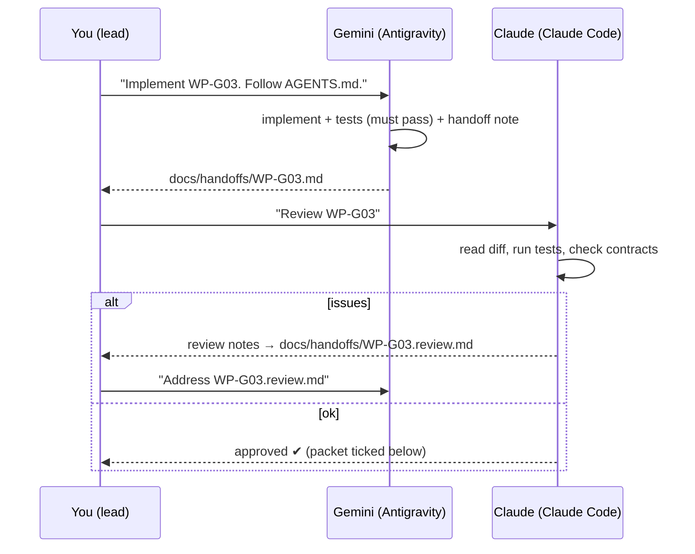
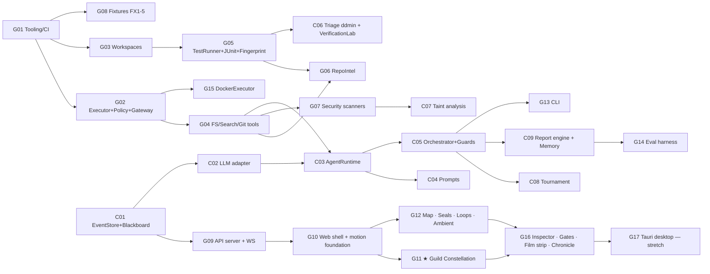

# 13 — Build Orchestration: Work Packets for Claude (core) & Gemini (UI, infra, tooling)

This supersedes the team split in `09-IMPLEMENTATION-PLAN.md` §2–3. Phases and the cut list in 09 still apply.

## 1. Division of labour

| Owner | Scope | Why |
|---|---|---|
| **Claude (architect / core)** | Data contracts, agent runtime, mode prompts, orchestrator, guards, decision dossier, tournament, triage/ddmin, verification lab, taint analysis, report rule engine, memory/reflection. **Also reviews every Gemini packet.** | Correctness-critical reasoning code where subtle errors break the whole system |
| **Gemini (Antigravity)** | Web UI, API server, CLI, tool implementations from precise specs, git workspaces, repo intel, test runner, scanners, fixtures, eval harness, Docker executor, packaging/CI | Well-specified, testable engineering with clear acceptance tests |
| **Human (team lead)** | Hands packets to Gemini, runs the review loop, makes product calls, records the demo | — |

### Already done (Claude)
- [x] `devpilot/core/models.py`: all data models (frozen)
- [x] `devpilot/core/events.py`: event vocabulary (frozen)
- [x] `devpilot/core/ports.py`: subsystem interfaces (frozen)
- [x] `devpilot/engine/modes.py`: Mode Registry, 18 modes
- [x] `pyproject.toml`

## 2. The loop between Claude, Gemini and you



**Rules for every packet**
1. Read `AGENTS.md`, the packet, and the referenced docs before coding.
2. **Do not modify** `devpilot/core/models.py`, `events.py`, `ports.py` or `engine/modes.py`. If a change is needed, write it under "Contract change requests" in the handoff note.
3. Implement against the **Protocols** in `ports.py`.
4. Each packet ships with tests, and `python -m pytest -q` and `ruff check .` must pass (plus `npm run typecheck && npm test` for web).
5. Write `docs/handoffs/WP-XXX.md` using the template in §6.
6. One packet = one branch `wp/<id>-<slug>` = one commit series.

## 3. Dependency graph



**Critical path:** G01 → G02 → G04 → C03 → C05 → (FX2 end-to-end). Gemini's G09–G12 (UI) run in parallel against **recorded event fixtures** (G09 ships a `fake_mission` generator), so the UI never waits for the engine.

---

## 4. Gemini work packets

### WP-G01 — Tooling, CI, repo hygiene
**Goal:** a reproducible dev environment.
- `.gitignore` (`runs/`, `.venv/`, `node_modules/`, `web/dist/`, `.env*`, `__pycache__/`, `.pytest_cache/`, `.mypy_cache/`, `.ruff_cache/`).
- `devpilot.example.toml` exactly as in README §Configuration, extended with the `[models]` tiers (`frontier`, `workhorse`, `fast`) and `[profiles.fast|balanced|careful]`.
- `config/policy.toml` from docs/05 §3.
- `devpilot/config.py`: loads `devpilot.toml` → pydantic `Settings` (models per tier, budgets → `core.models.Budgets`, gates, chaos, sandbox tier, profiles). Env var overrides use the `DEVPILOT_` prefix. `ANTHROPIC_API_KEY` is read from env only and never logged.
- `Makefile` **and** `tasks.ps1` (Windows) with: `install`, `lint`, `typecheck`, `test`, `web-dev`, `web-build`, `serve`, `demo`.
- `.github/workflows/ci.yml`: matrix `ubuntu-latest`, `windows-latest`; Python 3.11; ruff, mypy (core only), pytest; a web job running typecheck + vitest.
- `tests/test_contracts.py`: imports every model; asserts every `ModeSpec.output` produces a JSON schema; asserts the Verifier's recipe hides `change_report`.
- **Accept:** `make lint test` green on a fresh clone; CI green on both OSes.

### WP-G02 — Executor, Policy, Tool Gateway
**Spec:** docs/05 §2–§7, `ports.ToolGateway`, `ports.Executor`, `ports.ToolContext`, `ports.ToolResult`.
- `devpilot/tools/executor_local.py`: `LocalExecutor` using `asyncio.create_subprocess_exec` (never shell). Scrubbed env (docs/05 §3), timeout → kill the process tree (`psutil` on Windows), stdout/stderr capped at 5 MB.
- `devpilot/tools/policy.py`:
  - `resolve_in_workspace()` path jail (symlinks, `..`, absolute paths, Windows drive letters and UNC paths).
  - Write-deny / read-redact globs.
  - Command matcher: three tiers (allow/ask/deny), default deny, metacharacter rejection, first token resolved by `shutil.which` basename (strip `.exe`).
  - **Test-assertion protection:** given old/new content of a test file, compute removed or changed `assert` statements and added `skip`/`xfail` markers via `ast` → deny unless `ctx.may_edit_tests`.
- `devpilot/tools/gateway.py`: `DefaultToolGateway` pipeline: schema validate (jsonschema) → `ctx.allowed_tools` check → policy → circuit breaker (3 consecutive failures → open for the mission) → run → redact secrets (regex set from docs/07 §3) → truncate (first 60 + last 140 lines) → `EvidenceLedger.record` → emit `TOOL_CALL`/`TOOL_RESULT`/`POLICY_DENIED`/`TOOL_UNAVAILABLE`/`CIRCUIT_OPENED`. Tool names: dotted internally, `_` for the API (`fs.edit` ↔ `fs_edit`). Every tool schema gets a required `rationale` string injected by the gateway.
- `devpilot/tools/ledger.py`: `FileEvidenceLedger`, which writes raw output to `runs/<id>/evidence/E-0001.log`, sha256 and sequential ids (thread/async safe).
- `DEVPILOT_DISABLE_TOOLS` / `[chaos].disable_tools` makes named tools return `TOOL_UNAVAILABLE` (so fallbacks trigger).
- **Tests (≥30):** traversal attempts (`../`, `..\\`, absolute, symlink out, `C:\\Windows`, `\\\\server\\share`), `.git/` writes, `.env` redaction, `rm -rf`, `git push`, `python -c` with `os.system`, `pytest; rm x`, unknown command, timeout kill, circuit opening after 3 failures, assertion-weakening edit denied, adding a new test allowed.

### WP-G03 — Git Workspaces
**Spec:** docs/05 §5, `ports.Workspaces`.
- `devpilot/workspace/git_worktrees.py`. Layout: `runs/<mid>/ws/main`, `ws/baseline` (detached at the original HEAD), `ws/cand-A..C`, `ws/scratch-*` (for ddmin).
- Non-git target: copy (respecting `.gitignore`) → `git init` → commit `devpilot baseline`.
- If the target is dirty at mission start, uncommitted changes are included via `git stash create` → the worktree is based on that snapshot (the user's working tree is not touched). Record this in mission metadata.
- `tree_sha` = `git write-tree` after `git add -A` in a **temporary index** (`GIT_INDEX_FILE`), so the user index is never touched.
- `hunks()` parses `git diff -U0` into `{id: "H1", path, old_start, old_len, new_start, new_len, patch}`; hunk ids are stable for a given diff.
- `checkpoint()` commits on branch `devpilot/<mid>` with message `devpilot: <label>`. `rollback()` uses `git reset --hard <sha>` *inside the worktree only*.
- `adopt(candidate)`: apply the candidate's diff (vs main) onto main and checkpoint it.
- `apply_to_target()`: refuse if the target is dirty, else `git merge --ff-only`. If not ff-able, refuse with instructions.
- **Tests:** a temp repo fixture; create/fork/diff/hunks/checkpoint/rollback/adopt/apply; dirty-target refusal; non-git target; Windows path handling.

### WP-G04 — Read/Write/Search/Git/Shell tools
**Spec:** docs/05 §1. Implement as `Tool` classes registered in `devpilot/tools/registry.py`:
`fs.list` (tree, depth ≤ 4, ignores), `fs.read` (line ranges, ≤ 400 lines, numbered output), `fs.edit` (exact unique match → `AMBIGUOUS_MATCH`/`NOT_FOUND` with the closest-match hint via `difflib`), `fs.write` (new files; overwrite only with a flag and when < 200 lines), `fs.write_probe` (to `runs/<id>/probes/`), `search.code` (ripgrep JSON → fallback Python `re` walker; identical output format), `git.status|diff|log`, `shell.run` (policy allowlist), `board.read` (blackboard slice → JSON), `msg.send` (creates an `AgentMessage` via Blackboard.emit), `memory.recall` (calls the MemoryStore port).
- Each tool's `ToolSchema` has a precise description (when to use it, when *not* to).
- **Tests:** each tool, happy path plus error codes; rg fallback parity test (same results with rg disabled).

### WP-G05 — TestRunner, JUnit, fingerprints, flaky detection
**Spec:** docs/06 §2–3, docs/11 §6 step 2, `ports.TestRunner`, `models.TestRun/TestCaseResult/TestClass`.
- pytest: `python -m pytest -q -p no:cacheprovider --junitxml=<ev>.xml -o junit_family=xunit2` (+ `--cov --cov-context=test --cov-report=json:<ev>.cov.json` for `baseline` scope).
- `devpilot/testing/junit.py`: robust parser (errors vs failures, skipped, xfail, setup errors, collection errors → synthetic case `__collection__`).
- `devpilot/testing/fingerprint.py`: docs/04 §6.2 normalisation; the same logical error must give the same fingerprint across Windows/Linux paths.
- Classification against the baseline run → `TestClass` (acceptance tests flagged from `mission.acs`/AcceptanceSuite paths; `EXPECTED_RED` for acceptance tests failing before DONE).
- `rerun_isolated(nodeid, times)` → flaky detection.
- Targeted scope: selectors from `RepoIntel.tests_covering()`.
- Emits a `TEST_RUN` event with totals and creates `TestRun` + `Evidence(kind=test_run)`.
- Node: `npm test` (exit code only) when `package.json` exists.
- **Tests:** a JUnit corpus (pass/fail/error/skip/xfail/collection error), fingerprint stability table, classification matrix.

### WP-G06 — Repo Intelligence
**Spec:** docs/11 §3, `ports.RepoIntelService`, `models.RepoIntel/Symbol/ConventionStat/FileRisk`.
- tree-sitter (via `tree-sitter-language-pack`) for py/js/ts. Python `ast` fallback.
- Symbol graph in `networkx` (defs, refs, imports, calls approximated by name resolution within module + imports).
- **Personalised PageRank:** personalisation vector = symbols whose names/docstrings match request tokens (snake/camel split, stemming-lite) + files mentioned in the request; `alpha=0.85`; return the top-k with signatures.
- Convention miner (numeric confidence): naming case ratios, type-hint coverage, docstring style detection (Google/NumPy/reST/none), quote style, error idioms (`raise ValueError` frequency), test style (functions vs classes, fixtures, parametrize usage), import style.
- Risks: churn (`git log --numstat`, if history exists) × radon complexity × coverage.
- `test_to_source` from the baseline coverage JSON contexts.
- Test command detection order: `pyproject [tool.pytest]` / `pytest.ini` / `setup.cfg` / `tox.ini` / `tests/` dir → pytest; `package.json scripts.test` → npm.
- **Tests:** on fixtures FX1–FX4: the expected top-5 symbols for each fixture request appear in the top-10 map; conventions detected correctly; test command detected.

### WP-G07 — Security scanners
**Spec:** docs/07 §3, `ports.SecurityLab.secrets/sast`.
- `scan.secrets`: regex set + Shannon entropy on string literals (AST for Python, regex otherwise), with allowlist comments `# devpilot: allow-secret`. Scopes: diff (added lines only) and repo.
- `scan.sast`: bandit JSON (if available) → normalise to `SecurityFinding` drafts; semgrep `--config p/python` (if available); **fallback AST rules** (table in docs/07 §3) implemented with `ast.NodeVisitor`.
- `introduced_by_change` computed from diff hunks.
- **Tests:** FX4 planted issues are all found by the fallback rules alone; no false positive on parameterised `execute("... ?", (x,))`.

### WP-G08 — Fixture repositories
**Spec:** docs/08 §1. Build `fixtures/fx1..fx5` exactly as described, each with:
- a realistic small package (3–6 files, ~150–400 LOC total, docstrings and type hints in a *consistent* style that differs between fixtures, e.g. FX1 Google docstrings, FX3 none),
- visible tests (`tests/`), a `.hidden/` grading suite (8–12 tests), `scenario.toml`, and `answers.json` where needed (FX5a, FX5c),
- `README.md` describing the planted defect **only inside `.hidden/NOTES.md`** (never in visible files).
- FX5 has three sub-fixtures: `fx5a_ambiguous`, `fx5b_tool_outage`, `fx5c_contradiction`.
- **Accept:** baseline states match the docs (FX2 green, FX3 red on exactly 2 tests, FX4 3 planted issues), and hidden tests fail on the unfixed code.

### WP-G09 — API server + WebSocket + fake mission generator
**Spec:** docs/12 §2. `devpilot/api/app.py` (FastAPI), `routes/*.py`, `ws.py`.
- Implement all REST routes against the `Blackboard`/`EventStore` ports. Use an in-memory registry of running missions plus a disk scan of `runs/`.
- WS frames exactly as specified, including JSON Patch (`jsonpatch`) and the reconnect protocol.
- `devpilot/api/fake.py`: `devpilot serve --fake` streams a **scripted FX2 mission** (≈250 events covering every EventType, a tournament, a dispute, a clarification and an apply gate) at realistic pace, so the UI can be built before the engine exists.
- `scripts/gen_types.py`: dumps JSON Schemas for `Mission`, `Event`, `Span`, `Evidence`, `HumanPrompt`, `HumanDecision` and the mode registry → `web/src/types/generated.ts` via `npx json-schema-to-typescript`.
- **Tests:** httpx TestClient for every route; WS reconnect with `from_seq`; patch application round-trip equals the snapshot.

### WP-G10 — Web shell & motion foundation
**Spec:** docs/12 §0, §1, §3, §4 (layout), §5.1–5.2, §6.11, §9, §10.
- Scaffold `web/` (Vite React TS strict, Tailwind, shadcn with the "Sumi & Vermilion" tokens as CSS variables, fonts).
- Router + View Transitions, providers, `api/rest.ts`, `api/ws.ts` (reconnecting, `from_seq`), `store/missionStore.ts` (incl. `presentation`, `quality`, `timeMode`), `lib/eventMeta.ts`, `lib/agentColors.ts`.
- **Motion foundation:**
  - `motion/tokens.ts`.
  - `motion/fxBus.ts` with a **pure `eventToFx`** covering every `EventType` (stubs allowed for effects whose components don't exist yet) plus `FxQueue` (concurrency cap, coalescing, reduced-motion mapping).
  - `motion/quality.ts` (detect-gpu tiers + WebGL availability).
  - `motion/sound.ts` (howler, muted default).
  - `motion/mood.ts` (pure mission → mood).
- Primitives: `Glass`, `Spotlight`, `Grain`, `MagneticButton`, `Odometer`.
- The Cinematic layout skeleton (Command Bar, left HUD, Stage slot, Inspector drawer, Film-strip slot) and the Focus layout (resizable three panes), with the shared-layout morph between them (`F`). `⌘K` palette and keyboard map.
- Launchpad ("The Gate", docs/12 §7) fully working, with fixture bento cards and a View Transition into the War Room.
- **Accept:** against `devpilot serve --fake`, the Command Bar, stepper and budget odometers update live; `eventToFx` has one unit test per `EventType`; Focus↔Cinematic morph works; reduced-motion verified; Lighthouse accessibility ≥ 90.

### WP-G11 — Guild Constellation ★ (signature visual, top UI priority)
**Spec:** docs/12 §6.1, §6.2, §6.6, §5.3 rows for MODE_STARTED, TOOL_CALL, POLICY_DENIED, MESSAGE_SENT/FINDING, TEST_RUN, MODEL_ESCALATED, TOURNAMENT_*.
- **G11a Agent Emblems:** `<AgentEmblem role state size>` for all 7 roles × 6 states (code-drawn SVG + motion). Storybook-style gallery page at `/dev/emblems` (dev only).
- **G11b Constellation 2D:** React Flow ring layout by guild, dynamic Samurai/candidate nodes, glowing nodes with emblems, SVG particle arcs driven by `Fx.particle`, recipient pulses, click → Inspector. This is the **guaranteed baseline** and must be finished first.
- **G11c Constellation 3D:** R3F scene with fresnel-rim emissive orbs, emblem sprites, instanced particle trails on Catmull-Rom arcs, bloom + vignette + noise, `CameraControls` auto-follow (`A`), double-click focus, ripple rings on test results, `frameloop="demand"` when idle. Same props and `Fx` interface as 2D; chosen by `quality`.
- **G11d Tournament choreography:** split (1.2 s) → score bars → crown/drift (1.4 s) in both 2D and 3D.
- **G11e Thought Stream:** per-word blur-in from `AGENT_TEXT_DELTA`, tool chips, collapsed thinking summary, jump-to-live.
- **Accept:** the fake FX2 mission plays end-to-end with every listed choreography row visible. A 60 fps trace at 1080p on `medium` (Chrome performance profile attached to the handoff). WebGL disabled → automatic 2D fallback with identical interactions. Playwright screenshot tests for idle, active particle, and tournament crown.

### WP-G12 — Campaign surfaces: Map, Seals, Loop Rings, Ambient
**Spec:** docs/12 §6.3, §6.4, §6.5, §6.7.
- **G12a Campaign Map:** Voronoi ink territories from the elk DAG layout, status fills, agent banners, the plan-revision ink wipe, version popover.
- **G12b Hanko Seals:** AC glass cards, confidence ring, VERIFIED stamp timeline (exact keyframes in §6.3), FAILED crack, evidence tooltip.
- **G12c Feedback Loop Ring:** attempt segments with hypothesis tooltips, odometer counter, crack-and-re-form on `STRATEGY_CHANGED`, hypothesis-diff view in the Inspector.
- **G12d Ambient Mood shader:** domain-warped ink noise with 5 moods and uniform lerping, plus a CSS gradient fallback; a contrast screenshot test (≥ 4.5:1 for HUD text).
- **Accept:** a fake mission run shows a plan revision wipe, ≥ 2 loop ticks including one strategy change, ≥ 3 seals, and mood transitions calm → failing → victorious.

### WP-G16 — Inspection, Gates, Time Travel, Chronicle, Proving Ground, Codex
**Spec:** docs/12 §6.8, §6.9, §6.10, §8.
- **G16a Inspector** (all entity kinds, structured output renderers, included-vs-hidden context chips).
- **G16b Focus tabs:** Timeline, Diff (Monaco + decorations), Tests heatmap, Trace waterfall, Tournament arena, Memory.
- **G16c Imperial Decree** apply gate (scroll unroll, hold-to-confirm 1.5 s, short-id typing when any AC is not VERIFIED, request-changes particle, reject burn) + Messenger cards for clarification/command/escalation/dispute + browser notifications.
- **G16d Film Strip:** keyframes, scrubbing with history snapshots (debounce + LRU), reverse-safe FX, **Replay 1×/2×/4×**, LIVE return. Backend: `GET /keyframes` (coordinate with G09).
- **G16e Chronicle** (report page + print theme), **Proving Ground** (eval charts), **Codex** (mode explorer).
- **Accept:** a full fake mission is driven to completion **only through the UI** (clarification, dispute, Decree approval), then replayed at 2× from the film strip.

### WP-G17 — Desktop app (stretch)
**Spec:** docs/12 §12. Tauri 2 shell, PyInstaller backend launched alongside, native notifications/tray/folder picker, `.dmg` + `.msi` builds, documented in README.

### WP-G13 — CLI
`devpilot run|serve|resume|approve|reject|abort|report|eval|modes|doctor`. `run` without `--ui` shows a `rich` live view (header, plan, latest events) and prompts in the terminal (`HumanChannel` CLI adapter). `doctor` checks git, python, rg, bandit, semgrep, docker and the API key, and prints which fallbacks will be used.

### WP-G14 — Eval harness
**Spec:** docs/08 §2–4. `devpilot eval` → `eval/results.json` + `eval/results.md`. Auto-approval only inside the eval temp dir (assert the path prefix). Hidden tests are copied in after the mission ends.

### WP-G15 — DockerExecutor
**Spec:** docs/11 §12. Image `devpilot/sandbox:py311` (`docker/sandbox.Dockerfile`, with pytest/coverage/hypothesis preinstalled). Run with `--network none --read-only --tmpfs /tmp --user 1000:1000 --cpus 2 --memory 2g`, worktree bind-mounted at `/work`. Auto-select it when Docker is available and `sandbox = "auto"`.

---

## 5. Claude work packets (core)

| ID | Packet | Key contents |
|---|---|---|
| C01 | EventStore + Blackboard | JSONL append with fsync, seq assignment, async fan-out, a projection reducer per `EventType` into `Mission`, `snapshot(at_seq)` via replay with snapshot caching every 100 events |
| C02 | LLM adapter | Anthropic Messages API: extended thinking, prompt caching (layered breakpoints), forced `tool_choice` for submit, streaming deltas → `AGENT_TEXT_DELTA`, retries with jitter, cost accounting, **cassette record/replay** keyed by request hash |
| C03 | AgentRuntime | Generic mode executor: ContextAssembler (slices, per-slice token budgets, hidden-slice enforcement), PromptCompiler (constitution + mode prompt + cached prefix), tool loop, compaction via the FAST tier, schema + semantic validators (`engine/validators.py`), repair rounds, model escalation |
| C04 | Prompts | `prompts/constitution.md` + 18 mode prompts, each with an output example and failure-mode warnings |
| C05 | Orchestrator | Mission/task state machines, scheduler with file locks, CHECKING fan-out, DecisionDossier builder, legal-action filter, guards, convergence monitor + auto-rollback, watch conditions, dispute protocol, human gates |
| C06 | Triage & VerificationLab | ddmin over hunks in scratch worktrees; differential runner (baseline vs main subprocess harness, JSON-serialised outputs); hypothesis property-test runner; AST mutation engine on changed lines; changed-line coverage; test-integrity AST diff |
| C07 | Taint analysis | Intraprocedural def-use + 1-hop interprocedural via the symbol graph; source/sink/sanitiser catalogue; `TaintPath` output |
| C08 | Tournament | Fork worktrees, parallel `samurai.explore`, deterministic scoring vector + gates, `judge.select`, adopt the winner, archive the losers |
| C09 | Report engine + Memory | AC status rules + deterministic confidence formula (docs/11 §7), Markdown/JSON report, loop narrative from events; SQLite FTS5 memory store, reflection writer, confidence decay |

## 6. Handoff note template (`docs/handoffs/WP-XXX.md`)

```markdown
# WP-XXX — <title>
**Status:** ready-for-review | blocked
**Branch:** wp/xxx-slug   **Commits:** <sha range>

## What I built
- …

## How to verify
make test   # N tests, all passing (paste summary line)
<any manual steps>

## Deviations from spec
- … (why)

## Contract change requests
- (none) | file / model / field — proposed change — reason

## Known gaps / follow-ups
- …
```

## 7. Progress tracker

| Packet | Owner | Status |
|---|---|---|
| Contracts (models/events/ports/modes) | Claude | ✅ done |
| G01 Tooling/CI | Gemini | ☐ |
| G02 Gateway & policy | Gemini | ☐ |
| G03 Workspaces | Gemini | ☐ |
| G04 Tools | Gemini | ☐ |
| G05 TestRunner | Gemini | ☐ |
| G06 RepoIntel | Gemini | ☐ |
| G07 Scanners | Gemini | ☐ |
| G08 Fixtures | Gemini | ☐ |
| G09 API + fake mission | Gemini | ☐ |
| G10 Web shell + motion foundation | Gemini | ☐ |
| G11a–e ★ Guild Constellation | Gemini | ☐ |
| G12a–d Map/Seals/Loops/Ambient | Gemini | ☐ |
| G16a–e Inspector/Gates/Film strip/Chronicle | Gemini | ☐ |
| G17 Tauri desktop (stretch) | Gemini | ☐ |
| G13 CLI | Gemini | ☐ |
| G14 Eval harness | Gemini | ☐ |
| G15 Docker | Gemini | ☐ |
| C01 EventStore/Blackboard | Claude | ☐ next |
| C02 LLM adapter | Claude | ☐ |
| C03 AgentRuntime | Claude | ☐ |
| C04 Prompts | Claude | ☐ |
| C05 Orchestrator | Claude | ☐ |
| C06 Triage/VerificationLab | Claude | ☐ |
| C07 Taint | Claude | ☐ |
| C08 Tournament | Claude | ☐ |
| C09 Report/Memory | Claude | ☐ |

**Suggested waves**
1. Gemini → G01, then G02 + G03 + G08. Claude → C01, C02.
2. Gemini → **G09 (fake mission server) → G10 → G11 ★**. Claude → C03, C04, C05. The UI is demoable on fake data at the end of this wave.
3. Gemini → G04–G07, G12, G13. Claude → C06–C09, reviews.
4. Gemini → G16, G14, G15, then G17 if time allows. Everyone → real-engine end-to-end on FX2, eval runs, demo recording.

> Because the UI is a large share of Gemini's work, run two Antigravity sessions in parallel during waves 2–3: one on the UI track (G09→G10→G11→G12→G16) and one on the infra track (G02–G08, G13–G15).
