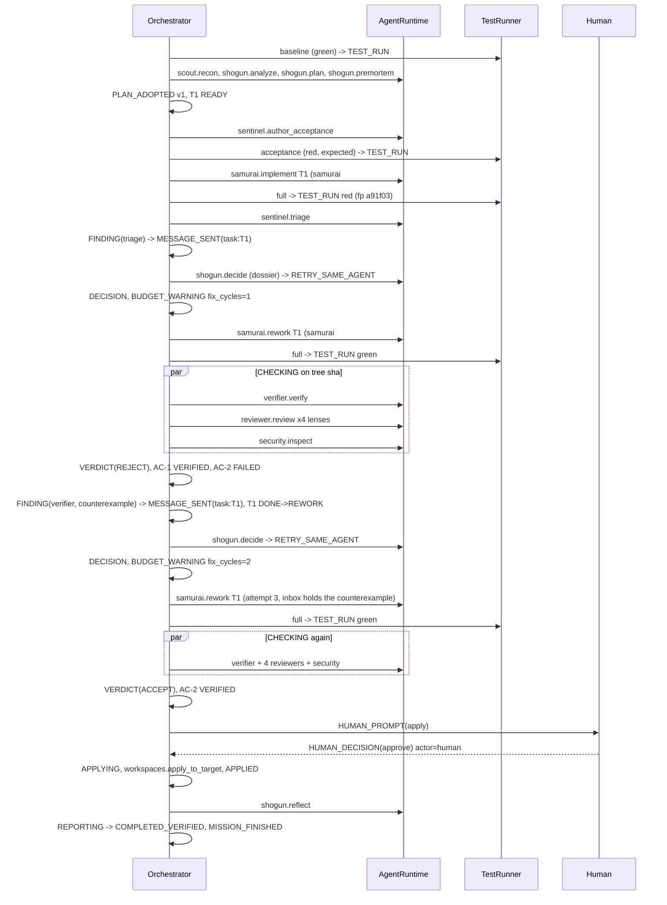

# WP-C05 - Orchestrator
**Status:** ready-for-review
**Branch:** wp/c05-orchestrator (from wp/core-integration)

## What I built
`devpilot/orchestrator/`
- `transitions.py`: `MISSION_TRANSITIONS`, `TASK_TRANSITIONS`, `assert_legal(frm, to)` (+ `IllegalTransition`). Docs/04 tables extended with INTEL, AUTHORING_ACCEPTANCE, TOURNAMENT; any live state may go to ABORTED/REPORTING/FAILED; terminal states have no exits.
- `ac_rules.py`: `ac_status(ac, mission, final_tree_sha)` (docs/06 s6), `confidence(ACVerdict)` (docs/11 s7), `supporting_evidence_ids`, `latest_verdict_for`.
- `progress.py`: `progress_vector(mission, task_key, *, tree_sha=None)`, `trend(history)`, `badness`, `verifier_fingerprint`.
- `guards.py`: `legal_actions(...)`, `override(...)`, `GuardCounters`, `effective_budget`, `best_checkpoint`, `fingerprint_repeats`. One `_evaluate` backs both functions so they cannot disagree.
- `dossier.py`: `build_dossier(mission, trigger_event, task_key, legal, *, budget=None)`.
- `scheduler.py`: `ready_tasks`, `batch`.
- `orchestrator.py`: `Orchestrator(blackboard, runtime, workspaces, tests, human, settings, *, repo_intel, ddmin, tournament, report_writer, reflect)` with `async run() -> MissionStatus`.

`tests/orchestrator/` (275 tests, ~40 s because the JSONL store fsyncs every event): unit tests per pure module, the five required e2e files, `test_orchestrator_behaviour.py` (28 scenario tests: plan gate, premortem amendments, parallel batches with a real concurrency barrier, ModeError as decision point, rollback, replan, investigate, tournament, review/security routing, stale verdict, watch conditions, cancellation, wall clock, human wait pausing the clock, repo-intel and ddmin paths) and `orch_helpers.py` (a `ScriptedRuntime` that records SUBMISSION and LLM_TURN events like the real `ModeRuntime`, fake workspaces/test runner/human, a real `EventSourcedBlackboard` over `JsonlEventStore`). Every e2e test finishes with `assert_replay_matches`: `EventSourcedBlackboard.load()` from disk equals the live mission.

## How to verify
```
python -m pytest -q tests/orchestrator   -> 275 passed
python -m pytest -q                      -> 586 passed
python -m ruff check .                   -> All checks passed
python -m mypy devpilot/orchestrator     -> Success: no issues found in 8 source files
```

## FX2 as asserted (`tests/orchestrator/test_e2e_fx2.py`)


## Behaviour notes
- **Fix cycles.** The projector ignores BUDGET_WARNING, so `mission.budget.fix_cycles` is never updated. The orchestrator keeps its own counter, emits `BUDGET_WARNING {"fix_cycles": n}` each time a fix cycle is *spent* (a decision pass that queued rework / tournament / replan), mirrors it into DECISION payloads, and feeds it to the guards via `GuardCounters`. `max_fix_cycles = N` therefore allows N fix cycles; the (N+1)th decision can only be STOP_PARTIAL. Verifier/review/security rejections count as cycles too, not just red tests (otherwise a verifier-reject loop would only be bounded by attempts).
- **Guards read the same counters** (`fix_cycles`, `tournaments`, `wall_clock_s`); `replans` is derived from `len(mission.plans) - 1`.
- **Deterministic decisions.** When the guards leave exactly one legal action (budget, fix cycles) or `shogun.decide` itself fails with a `ModeError`, the orchestrator records a `Decision` as a SUBMISSION (`agent_id="system"`, `model="deterministic"`) and the DECISION event points at it. No LLM call is wasted and the log still shows why.
- **Override order.** Hard narrowing wins (budget > human-escalation guards > soft removals). A human is preferred over the Shogun's `fallback_if_fails` when a guard demands one. Worsening progress + a better checkpoint turns any retry-like choice into ROLLBACK (`progress_worsening`).
- **Trend and checkpoints.** After each batch a checkpoint (progress unknown) is taken; after TESTING a best-so-far checkpoint with the progress vector is taken only when it beats every earlier one, so ROLLBACK targets always have progress data.
- **Evidence.** `TestRunner.run` returns only a `TestRun`. If its `evidence_id` is not already in `mission.evidence`, the orchestrator derives the `Evidence` record from the run (kind `test_run`, exit code 0 iff effectively green, `workspace_sha` = tree sha, `ac_ids` = ACs whose acceptance tests all passed per the `AcceptanceSuite`) and attaches it to TEST_RUN. A real runner that ledgers its own evidence takes precedence.
- **Effective red.** A run whose only failures are `STILL_FAILING` (pre-existing) or `FLAKY` is treated as green, so pre-existing failures cannot cause an endless red loop. They stay visible in the TestRun.
- **Verifier repeats.** Verifier FAILs get a pseudo fingerprint `v:<AC>:<sha1(counterexample)[:6]>` stored in the attempt, so the same counterexample twice is caught by `repeat_fingerprint_*`.
- **Findings lifecycle.** Triage findings are re-emitted `addressed` when the next run is green; review/security/verifier/investigation findings when CHECKING passes; `superseded` on replan. (So FINDING events can appear twice per finding id: open, then closed.)
- **Wall clock.** `asyncio.timeout(max_wall_clock_s)` around the drive loop; time spent in `human.ask` pauses it. Expiry -> BUDGET_EXCEEDED, COMPLETED_PARTIAL, report written. A 400-iteration phase cap is a second line of defence.
- **Terminal states.** COMPLETED_VERIFIED only if applied and every `must` AC is VERIFIED. FAILED is reserved for unrecoverable orchestration errors (a critical mode failing twice, an unexpected exception). Stopping with nothing verified is COMPLETED_PARTIAL, as the packet's e2e tests require (docs/04 says FAILED for "no AC verified").
- **Cancellation** emits REPORTING (reason "mission cancelled"), shields the report write, ends ABORTED, then re-raises `CancelledError`.
- **Unknown apply answers** (neither approve, request_changes nor text) are treated as reject: never apply on an unclear answer.
- Optional `gates.escalation = false` turns ASK_HUMAN into STOP_PARTIAL; `gates.clarification = false` skips the clarification gate.

## Deviations
- `legal_actions` / `override` take extra optional kwargs (`counters`, and `tournament_available` on `override`) beyond the packet signature.
- `ABORT` is never offered by `legal_actions` (a human aborts via the escalation prompt); if the Shogun picks it, it is overridden (`not_in_legal_set`). The executor still handles ABORT defensively.
- Plan-gate edits and replans do not run the premortem again; plan edits use up replans (`PlanRecord` v2).
- `scout.investigate` -> `recommends_replan` falls back to a plain rework when `max_replans` is exhausted.
- Baseline tests run in `main` (the untouched worktree) with `scope="baseline"`; the orchestrator does not call `create_main` / `create_baseline` (wiring must).
- `STATE_CHANGED CHECKING -> CHECKING` is used (and is legal) for the stale-verdict re-run; `DECIDING -> CHECKING` and `TESTING -> EXECUTING` were added to the mission table.
- Added transitions `BLOCKED -> REWORK`, `ESCALATED -> REWORK` to the task table (a decision / human guidance resolves a block).

## Contract change requests
1. **Projector: make fix cycles (and tournaments, wall clock) event-sourced.** Handle `BUDGET_WARNING` payloads `{"fix_cycles": n}` (and e.g. `tournaments`, `wall_clock_s`) in `projector.py` by setting `mission.budget.*`. Today `mission.budget.fix_cycles` is always 0, `BudgetState.ratio()` ignores fix cycles, and a resumed mission loses the counter. Orchestrator already emits these payloads.
2. **TestRunner / evidence ledger.** `TestRunner.run` returns only `TestRun`; the runner (or a `ledger` port on it) should emit `TOOL_RESULT`/`TEST_RUN` evidence with `ac_ids` and `workspace_sha`. The orchestrator currently synthesises the Evidence from the run.
3. **`Workspaces.hunks()`** needs a fixed schema (`path`, `new_start`, `new_lines`); the orchestrator parses tolerant keys like the runtime does.
4. **Finding status updates** have no dedicated event; the orchestrator re-emits `FINDING` with the new status. A `FINDING_STATUS_CHANGED` event (or an `AGENT_MESSAGE` consumption event) would be cleaner.
5. **`HumanDecision` cancel semantics** are unspecified; the orchestrator treats `choice in {"cancel","abort"}` or an empty answer as cancel at the clarification gate.

## Known gaps
- Samurai `ChangeReport.requests` (questions for Scout/Shogun) and `DISPUTE` flows (docs/04 s7, `shogun.adjudicate`) are not orchestrated.
- No `MEMORY_RECALLED` / `MEMORY_WRITTEN` emission and no `MemoryStore` wiring; `shogun.reflect` runs but its lessons are not persisted here.
- The tournament is only the injection point (`tournament(task_key, hints) -> winner`); C08 emits the TOURNAMENT_* events. Parallel `samurai.explore` worktrees are not created here.
- Multi-task progress vectors are mission-wide (latest TestRun), only fingerprints are attributed per task (via triage routing). Best-so-far checkpoints use the first task with attempts.
- Mission resume (`events.jsonl` -> continue) is not implemented: `run()` expects a CREATED mission; local counters are not rebuilt from the log.
- `request_changes` at the apply gate triggers one decision for the first live task only.
